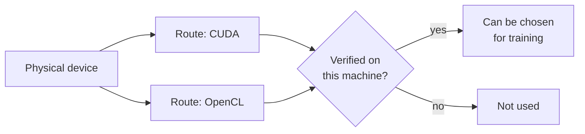

The Engine computes with **ArrayFire**, a tensor library with one back end
per kind of device. Each operation is written once against ArrayFire and
runs on whichever back end is active, with the data kept on the device. A
few layers run on CyxWiz's own GPU kernels instead; see
[What runs where on a GPU](gpu-providers.md).

## The back ends

| Back end | Devices | Comes with | Platforms |
| --- | --- | --- | --- |
| **CPU** | Every computer | The Engine itself | Windows, Linux, macOS |
| **CUDA** | NVIDIA GPUs | The NVIDIA CUDA GPU pack | Windows x64 |
| **OpenCL** | NVIDIA and Intel GPUs (AMD untested) | The OpenCL GPU pack | Windows x64 |
| **oneAPI** | Intel GPUs and CPUs | The Intel oneAPI GPU pack | Windows x64 |

A **GPU pack** installs one of ArrayFire's GPU runtimes beside the Engine,
in its install folder. Nothing is installed system-wide and no driver is
installed: the GPU vendor's driver must already be there. Linux and macOS
installs compute on the CPU. Installing a pack is described in
[Add a GPU pack and verify it](../install/gpu-packs.md).

## Devices, routes and verification

One GPU can be reached through several back ends: an NVIDIA card through
CUDA and OpenCL, an Intel GPU through OpenCL and oneAPI. Each pair of
device and back end is a **route**. **Preferences > Devices** shows a card
per physical device with its routes.

Training uses only routes that passed **verification** on your machine.
**Verify all** runs a short qualification of each route in a separate
process, so a crashing driver cannot take the Engine down, and records the
measured speed of a fixed dense benchmark. **Use fastest route** picks the
fastest verified one; a real model's speed can differ.

On Intel GPUs the Engine recommends OpenCL. oneAPI is known to fail on Intel
UHD 630 while the device activates; see the
[known issues](../known-issues.md).

## The CPU fallback and the execution policy

Every run binds the route from **Preferences > Devices** on its own thread
and records it in the run's log and trace. What happens when that route
cannot run something is set by the **execution policy**:

| Policy | When the GPU cannot run the work |
| --- | --- |
| **Compatibility (may finish on ArrayFire CPU)** (the default) | The run, or the stage the GPU cannot take, continues on ArrayFire's CPU back end, and the Engine says so with the reason. |
| **Strict (stays on the selected device)** | The run refuses to start, or stops, with the reason. Nothing moves to the CPU. |

The CPU fallback is the same ArrayFire code on the CPU back end, not a
second implementation, so results agree with the GPU's to the usual
float32 differences (see [Numerical accuracy](numerical-accuracy.md)).
Reasons the Engine reports include an unavailable back end, a GPU error,
an ArrayFire kernel that failed to compile, GPU memory exhausted, and an
unsupported data type, shape or operation.

Before a run, the compile report's **Where each layer runs** tab says which
layers run on the GPU, on the CPU, or on both, and which are at risk.

## One run per GPU

A training run on a GPU route holds that device for its whole life, across
Engines and tools on the same computer. A second run on the same GPU waits
for the first to end, so two runs never share one GPU's memory and time.
One GPU reached through CUDA and through OpenCL is still one device.

## Float32 and float64

- **Neural networks** train in float32 on every back end.
- **Analysis** (classic ML, clustering, data transforms, dimensionality
  reduction, linear algebra) runs in float64 where the device has it.
  GPUs without double precision, for example Intel Iris Xe, run it in
  float32; results then agree with the references to float32 precision.

## GPU memory

ArrayFire's memory manager keeps buffers it no longer needs, to reuse them
for the next tensors of the same size. The device therefore shows more
memory in use by the Engine than live tensors hold, and the amount does not
drop when a run ends.

- The Monitor window's **System** tab (**Tools > Monitoring**) shows what
  the Engine holds on its device (the buffers, and the part in use) and, on
  NVIDIA GPUs, what the device itself has free. See
  [Monitoring](../usage/monitoring.md).
- **Free unused memory** in the Monitor window returns the kept buffers to
  the driver and asks Python to collect its garbage. Memory in use stays.
- A run that runs out of GPU memory says so (`CW-G-0701` or `CW-M-0702`);
  a smaller batch or input is the usual fix. The compile report's
  **Memory of a training step (estimate)** shows the expected need first.

## Design choices

- **Written once, on the device.** One implementation per operation keeps
  the CPU and every GPU computing the same thing, and keeping tensors on the
  device avoids copies to and from the host between steps.
- **Verify before use.** A route is used only after it passed on this
  machine, because a driver that reports a device is not proof that it runs.
- **Say where it ran.** A fallback is always reported with its reason;
  Strict exists for runs that must prove they stayed on the GPU.

## Limits

- GPU packs are published for Windows x64 only.
- Small networks can be slower on a GPU than on the CPU; see
  [What runs where on a GPU](gpu-providers.md).
- Free device memory is known only on NVIDIA GPUs.

## Related

- [What runs where on a GPU](gpu-providers.md)
- [Add a GPU pack and verify it](../install/gpu-packs.md)
- [Compute back ends for contributors](../internals/architecture/compute-back-ends.md)
