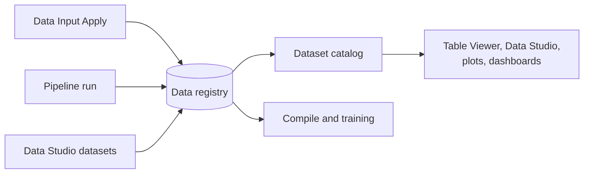
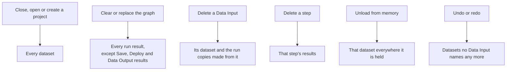

Every dataset the Engine holds lives in one place, the **data registry**,
under a name. Nodes, Data Studio, the Table Viewer, plots and training all
find data there by that name. Each dataset has an owner, and the owner's
end releases it. This page explains that model; what is held right now and
how to see it is in [Loaded data](loaded-data.md).

## The registry

The registry holds several kinds of dataset: tables in memory (Apache
Arrow), tables on disk (Parquet), sparse features, and image, audio and text
datasets. A **catalog** over it lists every dataset with its kind, rows and
memory, and tells the screens when one is added, replaced or removed. Each
change bumps the dataset's **generation**, which is how a Table Viewer tab
or a dashboard knows its rows are out of date.

## Who registers data

| Who | Registers | Name |
| --- | --- | --- |
| A Data Input's **Apply** | The file it reads | The node's dataset name, unique among the graph's Data Inputs (`mnist`, `mnist_2`) |
| A pipeline run (**Execute Pipeline**, **Train**) | Its copy of each input and each step's result | Run names such as `ds_datainput_<id>`, tied to the node id |
| Data Studio | The datasets you prepare and publish there | The name you give |
| A Plot or Dashboard | The in-memory copy of a disk table it reads | A name tied to its node |

A Dataset Input node only names a Data Studio dataset: it does not own it,
so deleting the node leaves the dataset alone.

## What releases data

Data goes when its owner goes:

- **Re-Apply with another file** keeps the old dataset until the new one has
  loaded and passed its checks, then releases the old one if the name
  changed. A failed load leaves you with the data you had.
- **Re-Apply with the same file** shares or replaces the table in place.
- **A run still going** keeps what it uses: deleting or clearing during a
  run releases its data when the run ends.
- **A Data Input still loading** blocks clearing or replacing the graph
  ("a Data Input is loading its data"), so the data cannot arrive after its
  node is gone.

The full table, with the frozen Table Viewer tabs and dashboards that stay
on screen, is in [Loaded data](loaded-data.md).

## Shared memory

Several names can point at the same table: a run's copy of its input, a
slice, the same file applied by two Data Inputs. The table is held once and
counted once. Releasing one name does not free the memory while another
name still holds it; the memory goes with the last name.

## Memory, disk and the caches

- **Host memory** holds tables in memory. The **data budget** in
  Preferences decides which tables stay on disk instead; see
  [Data bigger than memory](data-bigger-than-memory.md).
- **Device memory** holds the tensors of a run on the GPU. ArrayFire keeps
  freed buffers for reuse, so the Engine can look as if it uses more than a
  run needs; see [Compute back ends](compute-back-ends.md).
- **Disk caches** keep Parquet copies of loaded files and prepared training
  tables so they load fast next time. Opening a project prunes its caches:
  files older than 30 days go, then the oldest until the folder is under
  10 GB. A file a loaded dataset still reads is never removed. See
  [Disk caches](disk-caches.md).

## Design choices

- **One registry, one name per dataset.** Every screen sees the same data,
  and a release in one place is seen everywhere.
- **The registry is the truth.** Whether data is loaded is read from the
  registry, never from a flag a node remembers, so a background load that
  finished late is still seen.
- **Ownership follows the graph.** Data lives as long as the node, run or
  project that made it, so closing work frees its memory without a manual
  step.

## Limits

- A reopened project has its Data Inputs' settings but not their data:
  **Apply** or **Train** loads it again.
- Frozen Table Viewer tabs keep the rows they show until you close them.

## Related

- [Loaded data](loaded-data.md)
- [The data pipeline](data-pipeline.md)
- [Disk caches](disk-caches.md)
