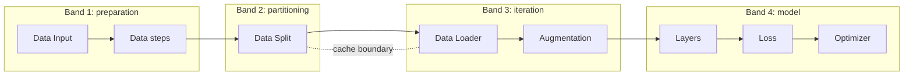

Every training graph moves its data through four bands, in order. The band a
node belongs to decides whether its result can be kept and reused, whether
it behaves differently while training and validating, and where leakage can
creep in.

## The four bands

| Band | Nodes | Behaviour | Reusable |
| --- | --- | --- | --- |
| **1. Preparation** | Data Input; data steps such as filters, SQL, joins, Fill Missing, scalers, encoders, tokenizers, TF-IDF, time-series windows, static resizing | The same for Train, Validation and Test rows. Deterministic for the same input and settings. | Yes |
| **2. Partitioning** | Data Split (random or stratified), Time Series Split (chronological) | Assigns each row to Train, Validation or Test. Deterministic for the same seed. | Yes |
| **3. Iteration** | Data Loader (batches, shuffling, epochs), image and audio augmentation, MixUp, CutMix | Knows the **phase** (train, validate or test) and changes behaviour with it. | No: runs every epoch |
| **4. Model** | Embedding, Dense, Conv2D, LSTM, attention, activations, Dropout, BatchNorm, losses, optimizers | Forward, loss, backward, weight update. Dropout and BatchNorm also read the phase. | No: this is where weights change |

## The cache boundary

Bands 1 and 2 give the same result every time for the same data and
settings, so the Engine prepares them once and reuses the result. The
boundary sits between band 2 and band 3: everything up to the table the Data
Split reads can be kept; nothing after it can.

- **In a session**, after **Execute Pipeline** or a first **Train**, the
  next Train reads the prepared result instead of running the steps again,
  as long as nothing up to the Split's input changed. Editing a model layer
  keeps it.
- **Between sessions**, the prepared table can be kept on disk in the
  project and loaded after you reopen it. Its key covers the Data Input's
  file and every step's settings. See [Disk caches](disk-caches.md).

## The phase

The phase (train, validate, test) exists only from the Data Loader on. The
loader switches its batchers between the Train, Validation and Test rows
without rebuilding them, and the model layers that care (Dropout,
BatchNorm) follow the same phase: BatchNorm updates its running statistics
while training and uses them while validating.

A band-3 or band-4 node can therefore never move into band 1: before the
Data Loader there is no phase to read. Random augmentation of a training
image is band 3 for the same reason, while resizing every image to one size
is band 1.

## Leakage between the bands

Leakage happens when a band-1 step learns from rows it should not see. A
scaler fitted on every row before the split has read the Validation and Test
rows, and their scores then read better than new data would.

The Engine prevents most of it. The pipeline run marks each row Train,
Validation or Test by the Data Split's rule before the first step, and
steps that learn (scalers, Fill Missing, encoders, vocabularies, TF-IDF,
PCA) fit on the Train rows only and then apply to every row. Steps that
cannot do that yet get a compile warning (`CW-C-0206`). The details are in
[Steps learn from the Train rows](steps-learn-from-train-rows.md).

Time series are split in order, never shuffled: shuffling would let the
model train on the future of the rows it is tested on.

## How data gets in

**Apply** in a Data Input dialog loads the data on a background worker. The
dialog stays usable while it loads: you can scroll the preview, switch tabs
or close the dialog. **OK** and **Apply** are off until the load ends;
**Cancel** stays on.

A table is held in one of two ways, chosen for you:

| Held as | When | How training reads it |
| --- | --- | --- |
| **A table in memory** (Apache Arrow) | The table fits the data budget | Batches are cut from memory. Whole-number columns are packed to the smallest type that holds their values (pixel columns to one byte). |
| **A table on disk** (Parquet) | The file is larger than the data budget allows, or the Data Input forces it | The file is memory-mapped and read a row group at a time; memory use is bounded by the system's page cache, not the file size. |

The rest of the graph does not see the difference: both register under the
same name and train with the same model, loss and optimizer. Image, audio
and text datasets index their files at Apply and read them as training
goes. See [Data bigger than memory](data-bigger-than-memory.md) for the
budget.

## Batchers

A **batcher** serves one part's batches (Train, Validation or Test) to the
training executor. There is one per kind of data: a table in memory, a table
on disk, images, audio, text and token sequences, and sparse features (for
TF-IDF and Count output). Each applies the Data Loader's batch size and
shuffling seed, and the training batches go through the band-3 nodes.

A prefetching batcher prepares the next batch on a worker thread while the
device trains on the current one. When the training set fits on the GPU it
is uploaded once, and each batch then sends only its row positions and
labels.

## Design choices

- **Nodes are real operations.** A data step transforms the table that
  flows through it; the result you see after Execute Pipeline is the data
  training reads.
- **One concern per node.** Normalize, Data Split and Data Loader are
  separate nodes, so each band boundary is visible on the canvas.
- **Smart defaults over settings.** Memory and speed come from how the data
  is held (packed columns, tables on disk, prefetching), not from options
  you must tune.

## Limits

- A prepared table is not kept on disk between sessions when a step keeps
  fitted state, runs SQL, or is not a table step; the steps run again after
  reopening the project.
- A table kept on disk is not marked by partition: its fitted steps learn
  from every row, and a warning says so.

## Related

- [How graphs run](how-graphs-run.md)
- [Data lifecycle](data-lifecycle.md)
- [Seeds and reproducibility](seeds-and-reproducibility.md)
