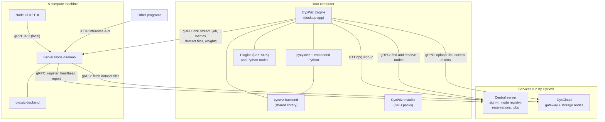
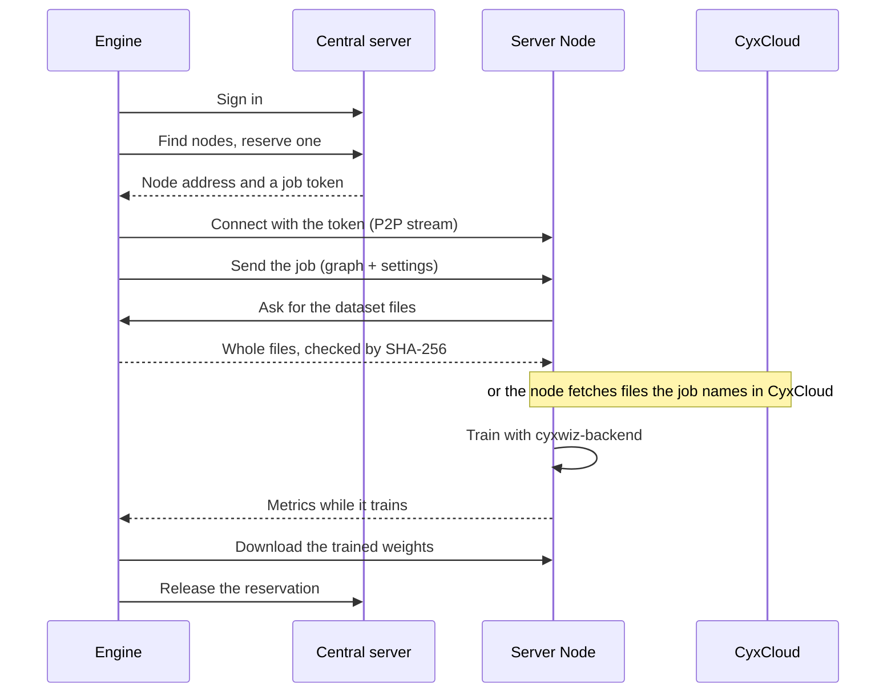

CyxWiz is a desktop application first. The **Engine** builds, trains, tests
and exports models on your own computer with no account and no network. The
other components add remote compute and cloud storage: a **Server Node**
trains a job on another machine, the **central server** signs you in and
finds and reserves nodes, and **CyxCloud** stores datasets for remote jobs.

## Every component and how they connect

| Component | Runs on | What it does |
| --- | --- | --- |
| **CyxWiz Engine** | Your computer (Windows, Linux, macOS) | The desktop app: graph editor, Data Studio, training, testing, export, Script Editor. All local work happens here. |
| **cyxwiz-backend** | Inside the Engine and the Server Node | The shared compute library: tensors, layers, losses, optimizers, data algorithms, devices. Both apps train with it, so a graph computes the same way on either. |
| **pycyxwiz** | Inside the Engine's embedded Python | The Python module over the backend, used by the Script Editor, the Python console and Python nodes. |
| **Plugins** | Loaded by the Engine | C++ libraries built with the Plugin SDK, and Python nodes (`.cyxnode` bundles), that add nodes, data formats, analyses and panels. |
| **CyxWiz Installer** | Your computer | Installs the Engine and the optional GPU packs (CUDA, OpenCL, oneAPI) beside it. |
| **Server Node** | A machine that offers compute | A daemon that registers with the central server, accepts training jobs from Engines and trains them; a GUI and a terminal UI (TUI) control the daemon over a local connection. It can also serve deployed models over HTTP. |
| **Central server** | Run by CyxWiz | Signs users in, keeps the registry of nodes and their heartbeats, finds nodes for a job and reserves one for a block of time. Its source is not public; the Engine and node use only its public interfaces. |
| **CyxCloud** | Run by CyxWiz | Dataset storage for remote jobs: a gateway the Engine and nodes talk to, and storage nodes behind it. Its source is a separate repository. |

The wire format between components is gRPC with Protocol Buffers, defined in
the `.proto` files of `cyxwiz-protocol`; sign-in is an HTTPS API. See
[The protocol](../internals/protocol.md) for the services.

## A remote training job, end to end

The node receives whole dataset files, checks each file's size and SHA-256,
then trains locally with the same training core the Engine uses. No batch
is streamed over the network during training. A dataset you keep in CyxCloud
is fetched by the node from CyxCloud, so it never passes through your
computer. A supplied Test input never leaves the Engine.

Disconnecting from a node keeps the reservation, so you can connect again
until its time ends; releasing it ends the reservation.

## What runs where

- **Local training, testing, Data Studio, scripting and export** run only in
  the Engine, on the device chosen in **Preferences > Devices**. See
  [Compute back ends](compute-back-ends.md).
- **A remote job** runs in the Server Node daemon's process, on the node's
  own verified device.
- **Plugins and Python nodes** run inside the Engine's process, with the
  Engine's rights. See [Security](../security/index.md).

## What works offline

Everything on your computer: projects, graphs, data loading and
preparation, training, testing, the Studio Debugger, export, scripting and
plugins. Signing in, the server list, the Cloud Browser and remote training
need the network. GPU packs are downloaded by the installer; once installed
they need no network.

## Limits of the remote parts

The remote parts are newer than the desktop app. In this release:

- A remote job trains on **one node**.
- A node trains **tabular and sequence graphs** whose Data Inputs feed the
  Data Loader directly. The Engine ships each loaded table as an Arrow IPC
  file (a table kept on disk as its Parquet file). Graphs with data
  preparation steps (tokenizers, vectorizers, normalisation, time series,
  audio features) or image, audio or text folder inputs are refused with the
  reason; prepare such data in the Engine first.
- A job runs in the node's process and is **not sandboxed**: run a node only
  for Engines you trust. See [Security](../security/index.md).

How to reserve a node and train on it is in
[Server Connection](../server-and-cloud/server-address.md); datasets in CyxCloud are
in [Datasets that live in CyxCloud](../server-and-cloud/cyxcloud/datasets.md).

## Related

- [How graphs run](how-graphs-run.md)
- [Architecture for contributors](../internals/architecture/overview.md)
- [The protocol](../internals/protocol.md)
