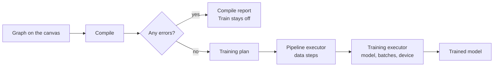

A graph on the canvas is a description: nodes with settings, and links
between their pins. Before anything runs, the Engine **compiles** the graph
into a plan, collects everything wrong or doubtful about it, and only then
hands the plan to the runner that fits what you asked for.

## From graph to run

## Compile

Compiling walks the graph in dependency order, from each Data Input to the
loss and optimizer, and builds the **training configuration**: the model's
layers, the data (dataset, where it is held, the split), the training loop
(epochs, batches, metrics, seed) and learning (loss, optimizer, learning
rate, labels). It also works out where each layer will run on the chosen
device (GPU, CPU, mixed, at risk, unsupported).

The Engine compiles about half a second after each edit, so the Studio
bar's chip stays current (in Data Pipeline mode it waits for **Compile**);
**Compile** (F7) shows the full report. Compiling runs nothing: it reads the
graph and the loaded data.

### Three levels of findings

A compile does not stop at the first problem. It collects every finding at
one of three levels:

| Level | Effect |
| --- | --- |
| **Error** | The graph cannot run as it is. Train and Local Debug stay off. |
| **Warning** | Train is allowed. Read it first: it often explains a poor result. |
| **Note** | Information only. |

A graph is ready to train when it has no errors. Each finding names its
node, or the graph as a whole, and many carry a stable code.

### CW codes

A code such as `CW-C-0201` is the same in the report, the Console, the logs
and the documentation, so it can be searched. The letter says where the
problem was found:

| Letter | Area |
| --- | --- |
| `C` | Compiling the graph |
| `R` | Running data steps (the pipeline) |
| `D` | The data: columns, labels, splits |
| `F` | Files: missing, unreadable, unsupported format |
| `M` | Memory: host, GPU, batch size |
| `G`, `P` | The GPU and CPU compute back ends |
| `T` | Training setup and training |
| `S` | Saving, loading and exporting models and checkpoints |
| `U` | The user interface (a missing selection, an invalid state) |
| `X` | External parts: optional integrations, plugins, Python, remote services |

The number identifies the problem within its area. A code ending in `0901`
is an internal check that should never fail: report it. Every code is listed
in [Error messages](../reference/error-messages.md).

### The data must be loaded

A Data Input's data counts as loaded only when the dataset is really in the
Engine's registry, not when its node says so. A reopened project keeps the
Data Inputs' settings but not their data, so a compile reports "not loaded"
(`CW-C-0201`) until **Apply** runs, or until **Train** loads them itself.

## Run modes and runs

The Studio bar's mode (**Code Gen**, **Data Pipeline**, **Local Training**)
decides what the extra button does; **Train** works in every mode. Each kind
of run has its own runner:

| Run | Runner | What it does |
| --- | --- | --- |
| **Execute Pipeline** | Pipeline executor | Runs the data steps up to the Data Split and keeps each step's result. |
| **Train** (F5) | Training executor | Prepares the data, builds the model, trains it on the chosen device. |
| **Local Debug** (F6) | Debug executor | One sample forward and backward, in the background; the Studio Debugger opens with the result. |
| **Run Test** (F8) | Test executor | The trained model on the test rows; results open in Data Studio. |
| **Code** | Code exporter | Writes the graph as Python (PyTorch, TensorFlow, Keras or PyCyxWiz). It has its own, older checks. |

Reinforcement-learning graphs (an Environment with Policy and Value Heads and
PPO) compile to their own training plan, and simulation graphs are ticked
live by the graph executor; both are covered in their own guides.

### The pipeline executor

Data steps (filters, SQL, joins, text and time-series steps, scalers and the
other Data Studio operations) run in the **pipeline executor**. It sorts
the steps in dependency order, runs each on Arrow tables (DuckDB for the
SQL-like steps), reports progress per node and can be cancelled. Large
results stay on disk under the data budget, and a step that makes the Engine
grow past the safe memory budget is stopped. See
[The data pipeline](data-pipeline.md).

Train reuses the last pipeline result when nothing up to the Data Split's
input changed: the result is keyed by the Data Input and every step's
settings. Editing a model layer keeps it; editing a data step prepares the
data again.

### The training executor

**Train** compiles first and refuses to start on errors ("Cannot start
training"). Then it loads any Data Input that is not loaded, runs the data
steps (or reuses their result), checks the label table for missing values
and checks memory. Only then does the training executor:

1. Binds the run to the device from **Preferences > Devices** and the run's
   execution policy (see [Compute back ends](compute-back-ends.md)).
2. Builds the model: a plain stack of layers, or a graph model when the
   graph has branches (Split, Add, Concatenate, layers with several inputs).
3. Builds the **batchers** that serve Train, Validation and Test batches
   from the prepared data.
4. Trains on its own thread, epoch by epoch: forward, loss, backward,
   optimizer step, then validation. Metrics flow to the Training Dashboard,
   and the best validation checkpoint is saved as it improves.

The steps before training are listed in detail in
[Compile and run a graph](../user-guide/graph-editor/compile-and-run.md).

## Design choices

- **Collect, do not stop.** Every finding at once is faster to fix than one
  error per attempt, and warnings let you train while you learn.
- **One gate for every run.** Train, Local Debug and remote jobs pass the
  same compile, so a graph that is ready to train here is judged the same
  way on a Server Node.
- **The registry is the truth.** Whether data is loaded is read from what
  the Engine holds, never from a remembered flag, which could be stale after
  a background load.
- **Snapshots, not live state.** A run works from what was compiled when it
  started; background runs never read the live canvas.

## Limits

- While a graph trains, tests, or runs a pipeline or simulation, the graph
  and the project are locked: loading or clearing a graph, and opening or
  closing a project, wait for the run to end.
- **Code** export checks the graph separately and can refuse a graph the
  compile report calls ready.
- One training run uses one device. On a GPU, one run at a time holds that
  GPU; a second run waits for it.

## Related

- [Compile and run a graph](../user-guide/graph-editor/compile-and-run.md)
- [Train a model and watch it](../user-guide/training/train-and-watch.md)
- [The data pipeline](data-pipeline.md)
- [Threading and background work](../internals/architecture/threading.md)
