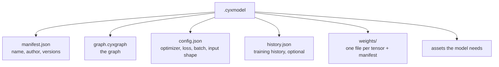

A trained model leaves the Engine in one of four forms: a **CyxWiz
package** (`.cyxmodel`) that can be opened and used again, a **training
checkpoint** kept by a run, a **weights file** for other frameworks, or
**Python code** that rebuilds the model elsewhere. The graph itself is saved
separately, as a `.cyxgraph` file in the project.

## The forms at a glance

| Form | Written by | Holds | Opens again in CyxWiz |
| --- | --- | --- | --- |
| `.cyxgraph` | Saving the graph | Nodes, settings and links; no weights | Yes, as the graph |
| `.cyxmodel` | **File > Export Model** (Ctrl+E) | The graph, the weights, the training configuration, optionally the training history, and the assets the model needs | Yes: **File > Open Model File** |
| Checkpoint folder | A training run (the best validation checkpoint) | The weights and the run's metadata | Yes: **Train > Test > Load Checkpoint for Testing**, or as the start of a new run |
| `.safetensors` | **File > Export Model** | The weight tensors only | As starting weights for a matching graph |
| Python code | **Code** on the Studio bar | The model as PyTorch, TensorFlow, Keras or PyCyxWiz code | No |

## The CyxWiz package

A `.cyxmodel` file is a single binary package (format version 3, "CYXW
v3"). Packages saved by older Engines as a folder can still be read. Inside
it:

The assets depend on the model:

- a text model's **tokenizer** (its configuration, vocabulary, and a
  SentencePiece model when it used one);
- a sequence-tagging model's **token, part-of-speech and tag vocabularies**;
- a tree model's **fitted trees**;
- a reinforcement-learning policy's **environment and observation
  normalisation**.

The graph is always included, because the graph is what rebuilds the model
around the weights; a graph with branches (Split, Add, Concatenate) is
rebuilt as that graph, with the same outputs. Opening a package loads its
graph onto the canvas, not its weights: train the graph, or load one of its
checkpoints for testing. How to export and open a package is in
[Exporting a model](../usage/export_import.md).

The optimizer's state is not saved in a package. A package holds up to
2 GB of content in up to 100,000 files; larger models do not fit.

## Training checkpoints

A run with **Save the best validation checkpoint** on keeps one checkpoint,
`best`, and replaces it whenever validation improves. A checkpoint folder
holds `metadata.json` (the epoch and step, losses and metrics, the learning
rate, the seeds, the Data Split it trained on), a `model/` folder with one
`.bin` file per weight tensor and a manifest naming each layer's parameter,
and a language model's tokenizer. It stores the weights, not the optimizer's
state.

Where checkpoints go and how to start a new run from one is in
[Checkpoints, early stopping and resume](../user-guide/training/checkpoints-and-early-stopping.md).

## Weights from and for other frameworks

**Export** to `.safetensors` writes the parameter tensors only, readable by
PyTorch and the safetensors library. It has no graph, so CyxWiz cannot open
it as a model on its own.

**Start from** reads pretrained weights into a matching graph: a PyTorch
state-dict (`.pth` or `.pt`, in the current and the pre-1.6 format) or a
`.safetensors` file. The Engine reads these files without PyTorch. A
PyTorch file contains a pickle, which in Python can run code when loaded;
the Engine reads it as data only, knows the few constructions a state-dict
uses, never imports or calls anything the file names, and refuses any other
object with the reason. See
[Start from pretrained weights](../user-guide/training/start-from-pretrained-weights.md).

Image layers store their data as height, width, channel; PyTorch uses
channels first. Importing and exporting weights convert between the two.

## ONNX

ONNX export (`.onnx`, for inference in other runtimes) exists in the code
but is offered only when the Engine was built with the ONNX exporter. The
released packages are built without it, so **File > Export Model** shows
the CyxWiz package and weights only. Where ONNX is built in:

- it is written from a plain stack of layers: a graph with branches is not
  offered ONNX;
- a model with an extension node (a plugin's or a Python node) is refused,
  because ONNX cannot describe the extension's computation.

GGUF is not written.

## Python code

**Code** writes the graph as Python for PyTorch, TensorFlow, Keras or
PyCyxWiz (the Engine's own Python module), into the Script Editor or a `.py`
file. A reinforcement-learning graph exports as Stable-Baselines3 PPO
(PyTorch code, whichever framework is chosen). The code holds the model's
definition, loss, optimizer and a commented example training loop, not the
trained weights.

### What each framework writes

| Framework | The model | Branches and merges | Loss and optimizer |
| --- | --- | --- | --- |
| PyTorch | An `nn.Module` class and its `forward` | Yes: an output read by several layers is kept, and **Add**, **Multiply**, **Average** and **Concatenate** combine their inputs. **Split** is not written. A graph with several input nodes, or a word and a part-of-speech **Embedding** joined by a **Concatenate**, is written as a chain | The graph's loss node and optimizer node, with their settings |
| PyCyxWiz | A class whose `forward` names every node's output | Yes, **Split** included | Adam and cross-entropy in the example loop |
| TensorFlow | A `tf.keras.Model` subclass | No: one straight chain; merge nodes are not written | Adam and sparse categorical cross-entropy |
| Keras | A `keras.Sequential` list | No: one straight chain; merge nodes are not written | Adam and sparse categorical cross-entropy |

Every framework refuses a graph that holds **Cross Attention**,
**Squeeze-Excitation**, **Linear Attention**, **Conv3D**, an image
transform or augmentation node, the **Quality Analyzer**, or an extension
node that is a layer or a loss: the file then holds a comment naming the
node and the reason. TensorFlow and Keras also stop at a **Transformer
Encoder**, **Transformer Decoder** or **Positional Encoding**, and at a
**LayerNorm** with a set `normalized_shape`. PyCyxWiz stops at a
**BatchNorm**, and at a **LayerNorm** set to `AUTO` whose width the graph
does not give. Those files raise `NotImplementedError` with the reason.
[Known issues](../known-issues.md) lists the exports that can write a model
other than the graph's.

The PyTorch export is tested: small models trained in the Engine and through
their exported code must agree step by step (see
[Numerical accuracy](numerical-accuracy.md)). **Code** runs its own checks
and can refuse a graph that the compile report calls ready.

## Design choices

- **The graph travels with the weights.** A package can always be opened
  again, and the weights never lose the structure that gives them meaning.
- **Weight files are data.** Reading PyTorch files without unpickling them
  as code lets you use published weights without running what is in them.
- **Say when a format cannot hold the model.** A model a format cannot
  describe is refused with the reason, never written incomplete.

## Limits

- No optimizer state in a package or in the best checkpoint: a new run from
  them starts its optimizer fresh.
- A package holds at most 2 GB.
- No ONNX or GGUF export in the released packages.

## Related

- [Exporting a model](../usage/export_import.md)
- [Checkpoints, early stopping and resume](../user-guide/training/checkpoints-and-early-stopping.md)
- [Start from pretrained weights](../user-guide/training/start-from-pretrained-weights.md)
