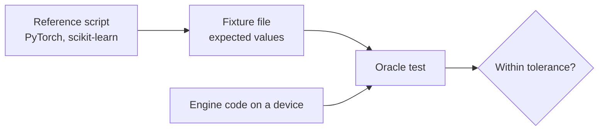

A result from the Engine and the same computation in PyTorch or
scikit-learn agree to the precision of the numbers used, not bit for bit.
This page explains what precision to expect, where the differences come
from, and how the Engine's results are checked.

## Precision of the numbers

| Work | Numbers | Agreement to expect |
| --- | --- | --- |
| Neural network training (layers, losses, optimizers) | float32 | About 7 significant digits per value; differences grow over many steps |
| Analysis on a device with float64 (classic ML, clustering, data transforms, dimensionality reduction, linear algebra) | float64 | Closed-form results to about 1e-8 |
| The same analysis on a GPU without float64 (for example Intel Iris Xe) | float32 | About 5e-5 relative; iterative and chaotic methods such as t-SNE agree less closely |

The Engine does not train in half precision (float16 or bfloat16).

## Why devices differ

- **Order of additions.** A GPU adds the terms of a sum in parallel, in a
  different order than a CPU. Float addition is not associative, so the
  last digits differ, and the difference grows with each training step.
  Losses after many steps agree closely, not exactly.
- **Library functions.** `exp`, `log` and `cos` may round differently in the
  last digit on each operating system and device (about 1e-7 for float32 on
  a GPU).
- **Fused kernels.** CyxWiz's own GPU kernels (recurrent cells, Conv2D and
  attention on CUDA, see [What runs where on a GPU](gpu-providers.md))
  combine steps differently from ArrayFire's, with the same float32
  precision.

Random draws are a separate matter: with the same seeds, the Engine draws
the same numbers on every platform and device. See
[Seeds and reproducibility](seeds-and-reproducibility.md).

## How results are checked: the parity oracle

The Engine's computations are compared with reference libraries by a set of
**oracle tests** in the source repository. PyTorch is the reference for
tensors, layers, losses, optimizers and training; scikit-learn for metrics,
classic models and text vectorizers; small reference implementations in
Python where no library fits. These libraries generate the expected values
once; they are not part of the Engine at run time.

The checks work at three levels:

1. **Operations.** Each layer's forward pass and gradients, each loss across
   its reductions (`none`, `mean`, `sum`) and edge cases, each optimizer over
   several steps including its state and resuming from it, the learning-rate
   schedulers, and the evaluation metrics (ROC, precision-recall,
   classification reports).
2. **Training.** Small models (an MLP with BatchNorm, a GRU regressor, a
   transformer encoder, a residual image block, a bidirectional LSTM) are
   trained for a few steps in the Engine and, through the Engine's own
   PyTorch code export, in PyTorch from the same starting weights. After
   every step the loss and every parameter must agree. The same run with
   the learning rate changed by 10 % must fail the comparison, which proves
   the check can fail.
3. **The data path.** A file goes through Data Input, a fitted scaler, the
   Data Split and the batchers as training reads them, and every row's
   part, the scaled values, each epoch's batch order and the training that
   follows are compared with Python reading the same file. Text, time
   series, images, audio and sparse features are checked the same way.

### Tolerances

| What | Tolerance |
| --- | --- |
| Training trajectory, per step (loss and every parameter) | absolute 2e-5, relative 2e-4 |
| Parameters no gradient reaches (they move by rounding noise) | absolute 1e-3 |
| Closed-form analysis in float64 | 1e-8 |
| The same in float32 | 5e-5 |

Each oracle test names the commit it was built from and the device it ran
on. A test asked to run on a device runs there or fails; it never passes by
quietly using another back end. Tests that train hold every run to that
device under the Strict policy.

### Where it runs

The oracle runs on ArrayFire's CPU back end on Windows and Linux for every
change, and on CUDA and OpenCL (and oneAPI where it runs) on machines with
those GPUs. A
coverage list records every public layer, loss, optimizer, scheduler and
batcher with the test that checks it, or the gap and why; a new component
without an entry fails the check.

## Known differences from PyTorch

- **Dropout masks** come from different random generators, so a dropout
  layer does not drop the same units as PyTorch. Its behaviour (the share
  dropped, the scaling) is checked on its own.
- **Image layout.** The Engine stores image rows as height, width,
  channel; PyTorch expects channels first. The code export and the weight
  import convert between the two.
- Behaviour that PyTorch defines is followed on purpose, for example binary
  cross-entropy's cap on `log` at -100.

## Limits

- Agreement is shown for the models and cases the oracle covers. A model
  built from other layers or settings is checked only through the parts it
  shares with them.
- On float32-only GPUs, analysis tolerances are float32's. For float64
  results, use the CPU route or a GPU with double precision.

## Related

- [Compute back ends](compute-back-ends.md)
- [Seeds and reproducibility](seeds-and-reproducibility.md)
- [The parity oracle, for contributors](../internals/parity-oracle.md)
