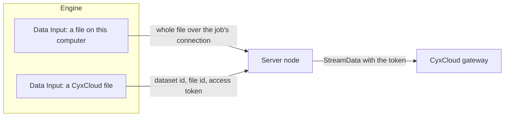

A server node has no copy of your data. For each remote job it fetches the
datasets the graph trains on as **whole files**, checks them, points the
graph's Data Inputs at them, and trains exactly as the Engine would. It
does not ask for one batch at a time over the network, so training runs at
the node's own speed once the files are there.

## Two sources

**From your Engine.** For a Data Input that reads a file on your computer,
the Engine sends the table it loaded at **Apply**:

- An in-memory table is written once as an Arrow IPC file, in the project's
  `.cyxwiz/remote-datasets/` folder (the system temp folder when no project
  is open), and deleted when the job is over.
- A dataset too big for memory (kept on disk as Parquet) ships its Parquet
  file as it is.
- The file travels in ordered chunks with its size and SHA-256; the node
  checks both before it uses the file.

**From CyxCloud.** A Data Input that names a file in a CyxCloud dataset is
not sent by the Engine. The Engine asks the gateway for an access token
scoped to that one dataset (valid until the reservation ends plus a few
minutes) and puts the gateway address, the file id and the token in the
job. The node streams the file from the gateway itself and checks it whole.
See [Train from a CyxCloud dataset](cloud-datasets.md).

## What is sent and what stays

- The training and validation inputs are sent.
- A supplied **Test** input (the Data Split's third pin) never leaves the
  Engine, whether it is a local file or in CyxCloud: test the trained model
  in the Engine.
- Only tables travel: Arrow IPC (`.arrow`, `.feather`, `.ipc`) and Parquet.
  Image folders, audio and text loaded as text datasets cannot be trained
  remotely yet.
- The graph must train from its Data Inputs as they are; data preparation
  steps (tokenizers, vectorizers, normalisation, time series, audio) run in
  the Engine before you send the job. See [Limits](limits.md#graphs).

## On the node

The files go to the node's job data folder (`CYXWIZ_NODE_DATA_DIR`, else
the system temp folder). A Parquet file larger than a quarter of the node's
data budget (half its memory) stays on disk and is read one row group at a
time while training, so a node can train on data larger than its memory.
See [Data bigger than memory](../concepts/data-bigger-than-memory.md).

A job that is checkpointed at the end of a reservation and sent again later
fetches its files again.

## Related

- [Run a remote job](run-a-remote-job.md)
- [Datasets from CyxCloud on a node](../server-and-cloud/server-node/cloud-datasets.md):
  what the node checks.
