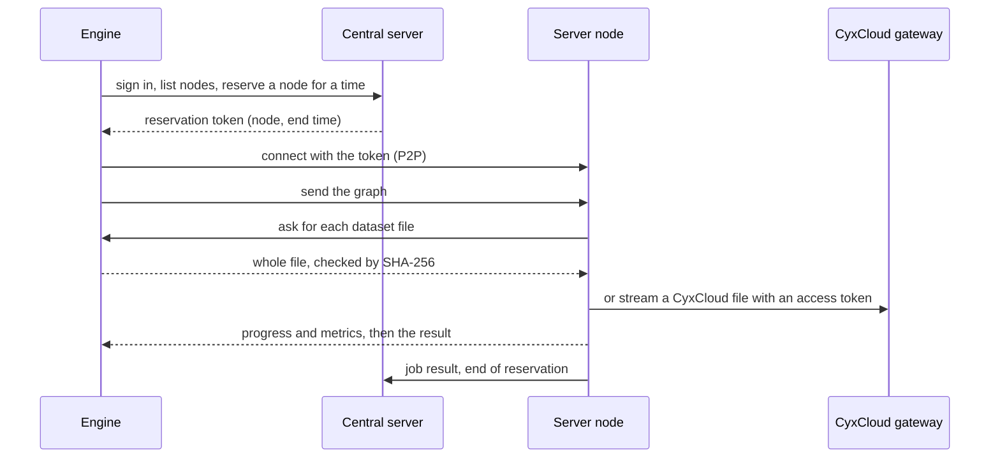

> **Experimental, not generally available.** Remote training works between
> machines you control, but it is not ready for the public: compute nodes
> accept some jobs without checking who sent them and run every job without
> a sandbox, and payments are not live. Read [Limits](limits.md) first.

The Engine trains on your own computer. Remote training sends a graph to
**one** other machine, a CyxWiz [server node](../server-and-cloud/server-node/index.md),
and trains it there: useful when that machine has a better GPU, more memory
or simply time to spare. Training one model on several nodes at once is not
in this build.

## How a remote job runs

1. **Reserve.** In **Deploy > Connect to Server...** you sign in, pick a
   node and reserve it for a block of time (10 minutes to 8 hours). The
   central server marks the node busy and gives the Engine a token naming
   the reservation, the node and the end time.
2. **Connect.** The Engine connects straight to the node (peer to peer) with
   that token; the node checks it.
3. **Send the job.** The Engine checks the graph can train remotely and fits
   the node, then sends it.
4. **Ship the data.** The node fetches each dataset file whole: from your
   Engine, or from CyxCloud when the dataset lives there. See
   [How data reaches the node](data-shipping.md).
5. **Train.** The node trains with the same training code as the Engine.
   Progress shows in the Engine's **P2P Training** panel.
6. **End.** When the reservation's time runs out, the node checkpoints and
   stops a running job; it resumes in a new reservation. You can extend the
   reservation, or leave and come back while it runs.

## The parts

| Part | Role | More |
| --- | --- | --- |
| Engine | Builds the graph, reserves, sends the job and its data, shows progress | [Run a remote job](run-a-remote-job.md) |
| Central server | Lists nodes, takes reservations, signs tokens, records results. Run by CyxWiz; closed source | [Servers and CyxCloud](../server-and-cloud/index.md) |
| Server node | Trains the job on its CPU or GPU | [Server node](../server-and-cloud/server-node/index.md) |
| CyxCloud | Optional: holds datasets the node streams itself | [CyxCloud](../server-and-cloud/cyxcloud/index.md) |

## Pages in this section

- [Run a remote job](run-a-remote-job.md): reserve, connect, train, extend,
  leave and come back.
- [How data reaches the node](data-shipping.md): whole files from the Engine
  or CyxCloud.
- [Train from a CyxCloud dataset](cloud-datasets.md): point a Data Input at
  a file in CyxCloud.
- [Set up a test lab](set-up-a-lab.md): the machines and roles for trying
  remote training on your own network.
- [Limits](limits.md): what remote training cannot do yet.
