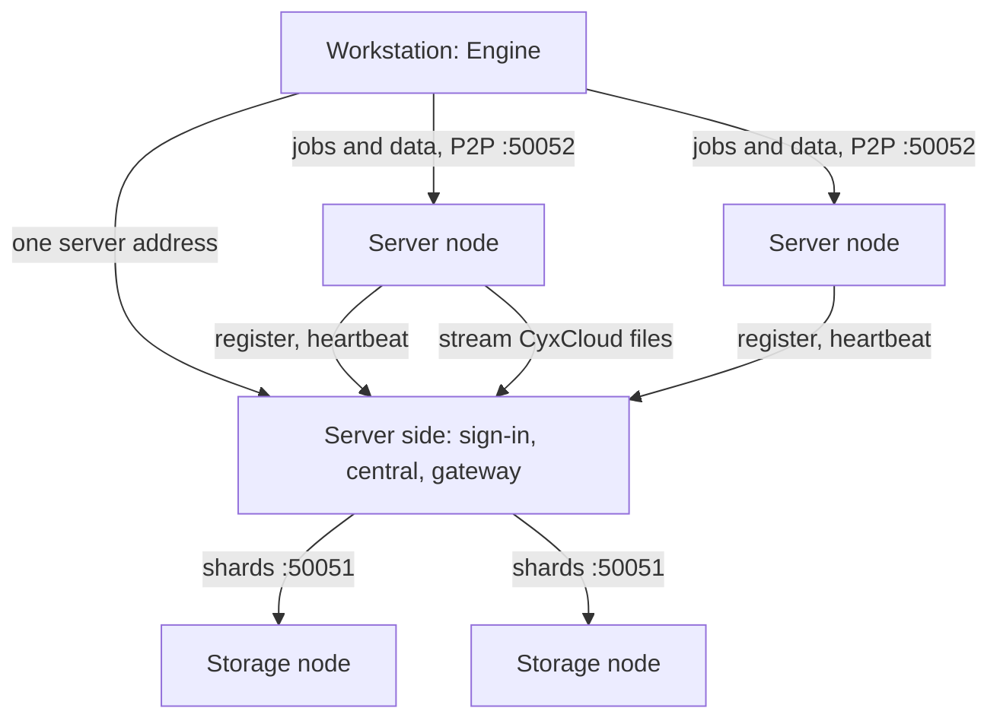

Use this to try remote training between machines you own, on your own
network, before anything else. One machine can hold several roles.

## Roles

| Role | What it runs | Notes |
| --- | --- | --- |
| **Workstation** | The CyxWiz Engine | Where you build graphs and reserve nodes |
| **Server side** | The CyxWiz sign-in API, the central server, the CyxCloud gateway and their databases, optionally a front door | One machine every client points at with one [server address](../server-and-cloud/server-address.md). The central server and sign-in API are run by CyxWiz; for a lab, point at a server side you have access to. |
| **Server node** | `cyxwiz-server-daemon` and `cyxwiz-server-gui` | Takes training jobs. Any operating system it builds on; a GPU is optional (the CPU runs through ArrayFire). |
| **Storage node** | `cyxcloud-node` | Optional: holds CyxCloud shards. Four or more are needed before losing one is survivable. |

## Steps

1. **Give every machine a fixed address**: a DHCP reservation on the router.
   Configs that name an address break silently when it moves.
2. **Set up remote logins** with ssh keys only, one key per machine. Use a
   password once to install a key, then do not keep it.
3. **Point every client at the server side**: the Engine in **Preferences >
   Servers**, each server node with `--server=` or **Settings > Network**,
   the `cyxcloud` CLI with `cyxcloud login --server`. Without a front door
   the server side serves central on 50051, the gateway on 50060 (gRPC) and
   8180 (HTTP), and sign-in on 3002; with one, a single port (8000, or 443
   with TLS).
4. **Build and start each server node** with the P2P secret of your central
   server. See [Run a server node](../server-and-cloud/server-node/run-a-server-node.md).
5. Optional: **start storage nodes** with `cyxcloud node init` and
   `cyxcloud node start`. See
   [Run a storage node](../server-and-cloud/cyxcloud/storage-node.md).
6. **Open only what each role needs** in each firewall: server nodes their
   P2P port (50052) to the workstation and their node service (50055) to the
   server side; storage nodes their shard port (50051) to the server side;
   the server side its service ports, or only the front door's. Keep every
   other node port closed. See [Ports](../server-and-cloud/ports.md).
7. **Check the path**: `cyxwiz-server-daemon --doctor` on each node,
   `cyxcloud doctor` on each storage node, and **What the Engine connects
   to** in the Engine's **Preferences > Servers**.
8. **Run a small job** end to end: reserve a node, train a small table for
   a few epochs, export the model. See [Run a remote job](run-a-remote-job.md).

## Rules for the lab

- **Secrets stay on each machine**, readable by their owner only: the P2P
  secret file, storage node keys and access secrets, sign-in files. Never in
  a repository, never in a log or a screenshot.
- **Keep the lab private.** The node services are not all authenticated and
  jobs run without a sandbox; see
  [Security notes](../server-and-cloud/security.md). Do not forward lab
  ports from the internet.
- **Keep machine details out of shared files.** Host names, addresses,
  ssh aliases and hardware notes belong in files your version control
  ignores.
- **One daemon per machine.** A second server node daemon refuses to start
  while the first owns the ports.
- **A machine that sleeps drops off.** After it wakes, a node whose Apply
  failed with "No route to host" needs **Retry** in its GUI.
