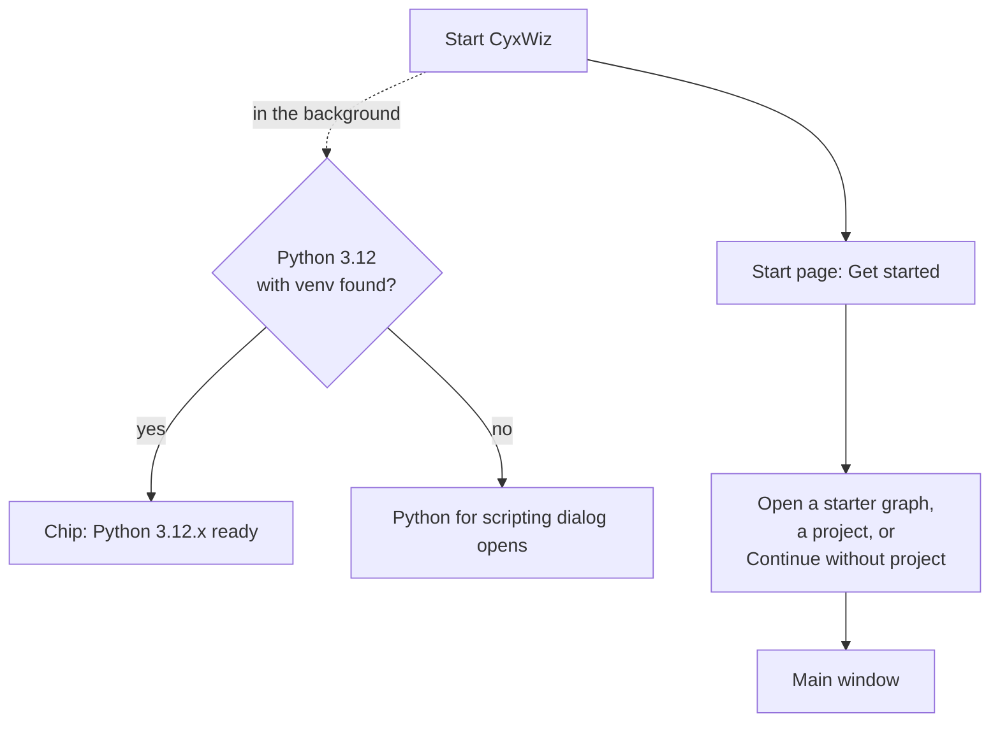

Use this when: CyxWiz is installed and you are starting it for the first
time.

## Before you start

- CyxWiz is installed: [Windows](windows.md), [Linux](linux.md) or
  [macOS](macos.md).
- Start it from the Start Menu (**CyxWiz**), your Linux application menu, or
  `CyxWiz.app` on macOS.

## What happens at start

1. The **Get started** page fills the window. It shows the Engine version and
   a Python chip at the top right. The full page is described in
   [The start page](../main-window/start-page.md).
2. In the background the Engine looks for a Python it can use. The chip reads
   **Checking Python...**, then **Python 3.12.x ready** (with your exact version), **Choose a Python** or
   **Python not found**.
3. If no usable Python is found, the **Python for scripting** dialog opens by
   itself. See [Python for scripting](#python-for-scripting).

## Open your first graph

The quickest way to see a working model is a task starter graph. Each one
comes with a small sample dataset, so it trains straight away.

1. On the start page, under **Task starter graphs**, find a starter:
   **Binary image classification**, **Multiclass image classification**,
   **Text classification**, **Audio classification** or
   **Time-series forecasting**.
2. Select **Open** on its row.

The main window opens with the graph in the **CyxWiz Studio** canvas, without
a project. To keep your own work, create a project instead:

1. On the start page, select **Create a new project** (Ctrl+N on the start
   page).
2. In **Create a new project**, choose a template, type a **Name**, and keep
   or change the **Location** (default `Documents/CyxWiz Projects`). The
   template sets only the default name and description; every new project
   starts with an empty canvas.
3. Select **Create**.

Select **Continue without project** to open the main window with nothing
loaded. Without a project, **File > Save** is not available, so create or
open a project before you build something you want to keep.

## Python for scripting

The Engine embeds Python 3.12. Scripts, the Python console and project
environments also need a Python 3.12 installed on your computer, with its
`venv` module. Building graphs, training and Data Studio work without it.

The **Python for scripting** dialog opens by itself when no usable Python is
found. You can also open it by selecting the Python chip on the start page.

| Part | What it does |
| --- | --- |
| **Usable** | Each Python the Engine can use, with its path and whether it has `venv` and `pip`. The one in use says **(in use)** |
| **Found but not usable (n)** | Pythons it found but cannot use, each with the reason |
| **Open python.org downloads** | Opens the Python download page (shown when nothing usable was found) |
| **Choose an interpreter...** | Pick a Python executable yourself |
| **Scan again** | Looks for interpreters again, for example after you installed one |
| **Use this Python** / **Done** | Keeps the selected Python |
| **Continue without scripting** / **Cancel** | Closes the dialog; without a Python, scripting stays off |

To set up Python:

1. Install Python 3.12:
   - Windows: from python.org; keep **pip** ticked in its installer.
   - macOS: from python.org, or `brew install python@3.12`.
   - Linux: see [Python for scripting on Linux](linux.md#python-for-scripting).
2. In **Python for scripting**, select **Scan again**.
3. Select the Python under **Usable**, then select **Use this Python**.

If you choose **Continue without scripting**, you can set Python later in
**File > Preferences... > Python**. The **Python for scripting** dialog
itself opens again only from the start page.

If you open a project before the scan has finished, the Engine shows
"Checking Python before opening the workspace..." for a moment.

## The main window

The first time, the main window uses the default layout. **CyxWiz Studio**
(the graph canvas) is in the centre, with **Asset Browser**, **Nodes** and
**Data Studio** beside it, **Properties** and **Info** on the right, and
**Console** at the bottom. A tool sidebar with one icon per panel shows and
hides panels. Later starts reopen the panels you had open.

Learn the window in [The main window](../main-window/index.md). To bring
the default layout back, use **View > Layout > Reset to Default**.

## Make the next start faster

To skip the start page, open **File > Preferences... > General** and set
**When the Engine starts** to **Reopen the last project**.

## If something goes wrong

**The start page shows no task starter graphs**: the Engine looks for
`examples/cyxgraph` next to itself. Installed releases include it; a moved or
partial install may not.

**"Python not found" although Python is installed**: the Engine needs
Python 3.12 with `venv`. Other versions are listed under
**Found but not usable** with the reason. Install 3.12, then select
**Scan again**.

**Training uses the CPU although you have a GPU**: add and verify a GPU
pack. See [Add a GPU pack and verify it](gpu-packs.md).

## Related

- [The start page](../main-window/start-page.md)
- [The main window](../main-window/index.md)
- [Add a GPU pack and verify it](gpu-packs.md)
