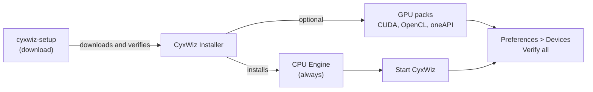

CyxWiz Engine is installed by a small **setup** program. The setup downloads
and checks the signed **CyxWiz Installer**, and the installer puts the Engine
and any GPU packs you choose on your computer. Nothing is installed
system-wide: every runtime the Engine needs lives in the install folder.

CyxWiz is in alpha. Releases are published as pre-releases on the
[Releases page](https://github.com/CYXWIZ-Lab/CYXWIZ/releases). Use the newest
one.

## How the pieces fit

- **CPU Engine.** Always installed. It holds the Engine, the ArrayFire CPU
  runtime and a Python 3.12 runtime for embedded scripting. Every machine
  can train on the CPU.
- **GPU packs.** Optional add-ons that let the Engine compute on a GPU. They
  are published for Windows only. See [GPU packs](gpu-packs.md).
- **CyxWiz Installer.** Stays installed. You use it later to add or remove
  GPU packs, update, and uninstall.

## Pick your platform

| Platform | Setup download | GPU packs | Guide |
| --- | --- | --- | --- |
| Windows x64 | `cyxwiz-setup-windows-x64.zip` | CUDA, OpenCL, oneAPI | [Install on Windows](windows.md) |
| Linux x86_64 | `cyxwiz-setup-ubuntu-x64.tar.gz` | None yet (CPU only) | [Install on Linux](linux.md) |
| macOS Intel | `cyxwiz-setup-macos-x64.tar.gz` | None yet (CPU only) | [Install on macOS](macos.md) |
| macOS Apple Silicon | `cyxwiz-setup-macos-arm64.tar.gz` | None yet (CPU only) | [Install on macOS](macos.md) |

Releases are built on Windows Server 2022, Ubuntu 22.04 and macOS 15. Older
operating systems are untested.

## What every install has in common

- **Signed packages.** The setup and the installer check the Ed25519
  signature of every package before they use it. A package that fails its
  check, or fails its local qualification, stays inactive.
- **No code-signing certificate yet.** Windows binaries are not
  Authenticode-signed and macOS binaries are not notarized, so your system
  may warn before the setup runs. Each platform guide says how to continue.
- **Python for scripting.** Scripts, the Python console and project
  environments need Python 3.12 installed on your computer, with its `venv`
  module. Graphs, training and Data Studio work without it. See
  [First launch](first-launch.md).
- **Your work stays yours.** Projects and datasets live outside the install
  folder, and uninstalling never removes them.

## Next steps

1. Install for your platform: [Windows](windows.md), [Linux](linux.md) or
   [macOS](macos.md).
2. Optional: add a GPU pack and verify it: [GPU packs](gpu-packs.md).
3. Start the Engine: [First launch](first-launch.md).
4. Later: [Update or uninstall](update-and-uninstall.md).

To build the Engine from source instead, see `INSTALL.md` in the source
repository.
