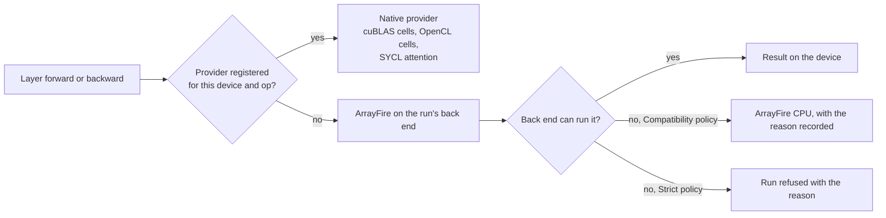

CyxWiz executes tensors through **ArrayFire** plus a small set of **native
neural providers** that register behind one interface. This page is the
contributor view: which executor runs what, how a provider is built and
loaded, and the decision record behind it. For the user view (what runs where
on a GPU, how to read the placement), see
[Compute back ends](../../concepts/compute-back-ends.md).

## Who executes what

ArrayFire is the general executor on every route: CPU (`AF_BACKEND_CPU`),
CUDA, OpenCL and oneAPI. CPU compute in the Engine means ArrayFire CPU; a
hand-written C++ loop is a recorded compatibility or debug path, not the
normal runtime.

The providers implement `INeuralNetworkProvider`
(`cyxwiz-backend/include/cyxwiz/neural_provider.h`) and are chosen per run
by the device the run targets:

| Provider id | Serves | Selected when | Build option |
| --- | --- | --- | --- |
| ArrayFire (no provider) | Every layer it can run: dense, convolution, normalisation, transformer blocks | Default | always |
| `cyxwiz.nvidia-cublas-cell` | Recurrent training (RNN, LSTM, GRU, stacked, bidirectional) and Conv2D forward and backward on CUDA | The run targets a CUDA device and the module is installed | `CYXWIZ_ENABLE_NVIDIA_DNN_PROVIDER` (OFF) |
| `cyxwiz.opencl-cell` | The same recurrent contract on OpenCL GPUs | The run targets an OpenCL device and the hidden size is 16 or more | `CYXWIZ_ENABLE_OPENCL_DNN_PROVIDER` (OFF); `CYXWIZ_ENABLE_OPENCL_CLBLAST` adds CLBlast GEMMs |
| `cyxwiz.oneapi-sycl-attention` | Fused attention on ArrayFire's oneAPI back end | The run targets a oneAPI device | `CYXWIZ_ENABLE_ONEAPI_DNN_PROVIDER` (OFF) |

Below a hidden size of 16 the OpenCL provider declines, because it is slower
than the portable path there, and the layer keeps the ArrayFire route.

`CYXWIZ_DISABLE_NEURAL_PROVIDERS=1` hides every provider for one process (the
portable path everywhere), for diagnosis and tests.



The execution policy (`core/execution_policy.h`) is **Compatibility** or
**Strict**. Under Compatibility a run that cannot stay on its device moves to
ArrayFire CPU and says why; under Strict it refuses. The oracle tests run
Strict, so a test can never pass by silently changing device.

## The NVIDIA provider

CyxWiz's own CUDA kernels, not cuDNN: fused RNN, LSTM and GRU cells and
im2col for 2D convolution, compiled at run time with NVRTC, with cuBLAS for
the matrix multiplies.

- **Why it exists.** ArrayFire's JIT flattens an expression tree into one
  kernel and cannot run recurrent training at useful sizes on any back end.
  ArrayFire 3.10's CUDA back end also fails to compile its own convolution
  kernel at real image sizes (`NVRTC_ERROR_COMPILATION`); its OpenCL and CPU
  back ends run Conv2D fine.
- **Device-resident Conv2D.** The provider runs convolution on ArrayFire's
  CUDA stream and device buffers with no host copies. The recurrent ops still
  stage data through the host. The log says `Conv2D: convolution via
  cyxwiz.nvidia-cublas-cell (...)`.
- **A module of its own.** `cyxwiz-nvidia-provider` (`.dll` / `.so`) is built
  beside `cyxwiz-backend` in `bin`. `cyxwiz-backend` links no CUDA library,
  so the base build runs on every machine. The release packaging ships the
  module only in the CUDA GPU pack (in `runtime/`, beside ArrayFire's CUDA
  library).
- **Loading.** The provider registry loads it at start, by name (the pack's
  `runtime/` is on the Engine's library path), then from beside
  `cyxwiz-backend`. The module exports `cyxwiz_nvidia_provider_abi` (must
  equal `CYXWIZ_NEURAL_PROVIDER_MODULE_ABI`, currently 3),
  `cyxwiz_nvidia_provider_register` and
  `cyxwiz_nvidia_provider_device_memory`. A missing module, or one that
  cannot load because there is no NVIDIA driver, counts as not installed. A
  loaded one logs `NVIDIA neural provider module loaded: <path>`.
- **Without it**, a CUDA run of a model with Conv2D does not stay on CUDA:
  Compatibility moves it to ArrayFire CPU and says why, Strict refuses.

## The OpenCL and oneAPI providers

- `cyxwiz.opencl-cell` uses hand-written tiled OpenCL GEMM kernels and the
  same fused cell kernels ported to OpenCL C. Its only requirement is an
  OpenCL ICD. It picks the device by the run's device index over all OpenCL
  GPU devices in platform order, the order ArrayFire uses on a single-vendor
  machine.
- `cyxwiz.oneapi-sycl-attention` keeps its kernels in a separate library,
  `cyxwiz-oneapi-kernels`, built with the Intel DPC++ compiler
  (`cyxwiz-backend/oneapi/`, compiler root in `CYXWIZ_ONEAPI_COMPILER_ROOT`).
  The provider loads it through a C ABI only while ArrayFire's oneAPI back
  end is loaded, so it binds the same SYCL runtime and the backend still
  builds with the host compiler. ArrayFire 3.10 exposes no SYCL queue to
  share, so data is staged through the host while the kernels run on the
  device.

## Decision: LibTorch is not an Engine back end

LibTorch is the numerical oracle of the parity tests, nothing more. No Engine
compute target (`cyxwiz-backend`, `cyxwiz-engine`, `pycyxwiz`) may link it.
The tests that link it are guarded by `CYXWIZ_HAS_PYTORCH`.

One other linker exists and is outside this decision: the server node's model
loader (`cyxwiz-server-node/src/model_loader.cpp`) can import external
TorchScript models for serving, as it imports ONNX and GGUF models. That is
format interoperability for models built elsewhere, off unless the build
finds LibTorch. It shares the `CYXWIZ_ENABLE_PYTORCH` option with the oracle.

Why not add LibTorch as another back end:

- **The gaps a provider exists for are closed without it.** Recurrent
  training is served by the native providers with CPU parity, leak checks
  and an end-to-end training gate. The ArrayFire CUDA transformer block runs
  fully on the GPU at scale (sequence 512, width 256: 16 to 20 times faster
  than ArrayFire CPU, with no fallbacks).
- **The provider boundary neutralises LibTorch's strengths.** Providers run
  single ops; CyxWiz keeps autograd, the optimizer and checkpoints. At that
  boundary LibTorch brings no fused autograd, subgraph execution or mixed
  precision.
- **The cost is concrete.** LibTorch 2.7.0 is 1.1 GB (CPU) or 4.7 GB in 36
  libraries (CUDA 12.6), pins a CUDA and compiler toolchain per release, and
  bundles cuBLAS and cuDNN libraries with the same names ArrayFire's CUDA
  back end loads (the first loaded wins; a mismatch is a crash or a silent
  numerical change).
- **Modern transformer variants do not need it.** RMSNorm, RoPE and ALiBi,
  GLU-family feed-forward layers, norm position and bias policy are small
  primitives implemented natively and checked against PyTorch fixtures.
- **Policy.** PyTorch is the numerical reference, kept outside the runtime,
  never a required Engine dependency.

### What would reopen it

Any one of these:

1. A measured ArrayFire failure at a shape the product needs, for a variant
   the native path cannot fix, recorded as placement evidence first.
2. A move to subgraph-level provider binding, where LibTorch's fusion and
   autograd would pay.
3. A device platform neither ArrayFire nor the native providers can serve.

If reopened, the shape is fixed: LibTorch enters as another provider behind
the same interface, for the transformer-block family only, shipped as an
optional pack the core installer never requires. ArrayFire stays first; the
provider is asked only for a contract the native path declares unsupported,
with an explicit per-run override, and the placement record shows requested
and effective provider so a switch is never silent. No duplicate palette
nodes per back end.

## Keep the oracle live

The oracle compares against LibTorch only when the build finds it; otherwise
the tests use the committed fixtures. For a developer build, use a dedicated
build directory (the reconfigure rebuilds broadly):

```bash
cmake -S . -B build-oracle -DCYXWIZ_ENABLE_PYTORCH=ON -DTORCH_DIR=<libtorch>/libtorch
```

Put `<libtorch>/libtorch/lib` on the library path when you run
`test_computation_truth_transformer_primitives`. See
[The parity oracle](../parity-oracle.md) for the whole harness.

## Related

- [Architecture overview](overview.md)
- [The parity oracle](../parity-oracle.md)
- [Compute back ends (user view)](../../concepts/compute-back-ends.md)
