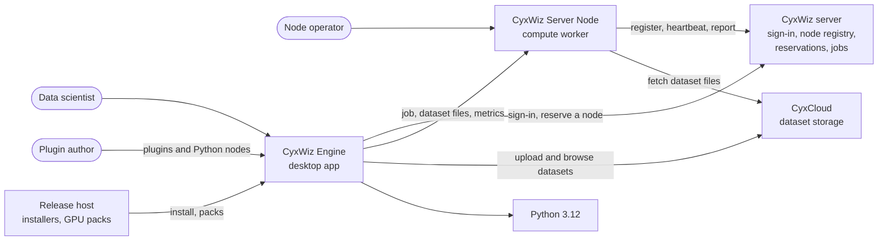
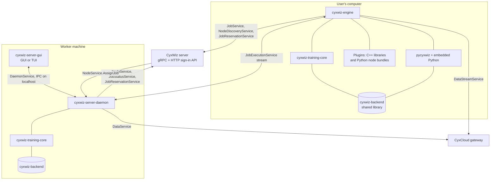
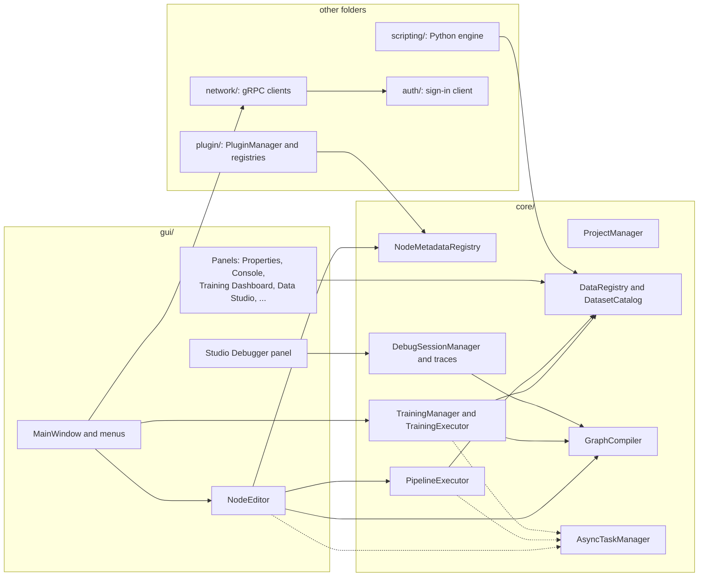
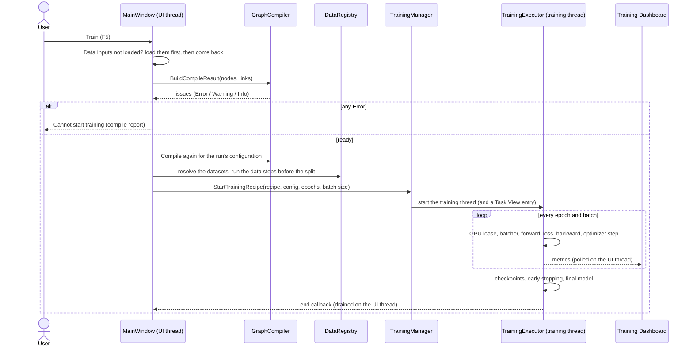

This page draws CyxWiz at three levels, the way the C4 model does: the
system in its surroundings, the programs it is made of, and the components
inside the Engine. It ends with what happens when you press **Train**. Each
diagram names real targets and folders, so you can go from a box to the
code. The user-level picture is [The CyxWiz ecosystem](../../concepts/ecosystem.md).

## Level 1: people and systems

- The **Engine** is where a model is built, trained, tested and exported. It
  works fully offline; the network parts are optional.
- The **Server Node** runs jobs other people send. It trains with the same
  compile-and-train code as the Engine.
- The **CyxWiz server** is the central service: it signs users and nodes in,
  keeps the registry of nodes, reserves a node for an Engine and tracks jobs.
  Its source is private; this repository has only its clients and the
  [protocol](../protocol.md) it speaks.
- **CyxCloud** stores datasets in its own repository and service; the Engine
  and the node reach it through its gateway.

## Level 2: programs and libraries

| Program | What it is | Built from |
| --- | --- | --- |
| `cyxwiz-engine` | The desktop app: GLFW window, OpenGL 3.3 (2.1 on macOS), Dear ImGui with ImNodes, ImPlot and ImPlot3D | `cyxwiz-engine/` |
| `cyxwiz-backend` | Shared library: tensors on ArrayFire, layers, losses, optimizers, algorithms, devices, neural providers | `cyxwiz-backend/` |
| `cyxwiz-training-core` | Static library shared by the Engine and the node: compiler, executors, batchers, checkpoints | `cmake/CyxWizTrainingCore.cmake` |
| `pycyxwiz` | pybind11 module over the backend, used by scripts and Python nodes | `cyxwiz-backend/python/` |
| `cyxwiz-server-daemon` | The worker process: job execution, deployment, inference, terminal, HTTP API, IPC | `cyxwiz-server-node/` |
| `cyxwiz-server-gui` | The operator's front end, a GUI or a terminal UI, talking to the daemon over IPC | `cyxwiz-server-node/` |
| `cyxwiz-installer` | Installs the Engine and manages GPU packs | `cmake/CyxWizInstallerTargets.cmake` |

## Level 3: inside the Engine

- **NodeMetadataRegistry** (`core/node_metadata_registry.cpp`) is the one
  list of node types. The Nodes panel, the search palette and the context
  menu read it; plugins and Python bundles add to it through the extension
  registry. See [Add a node](../add-a-node.md).
- **GraphCompiler** turns the canvas graph into a `TrainingConfiguration`
  with a list of issues at Error, Warning or Info level. The live compile
  (`core/live_graph_compile.h`) reruns it shortly after each edit.
- **DataRegistry** holds every loaded dataset by name: in-memory Arrow tables,
  Parquet-backed tables on disk, image, audio, text and sparse sets. The
  DatasetCatalog announces changes to subscribers on the UI thread.
- **PipelineExecutor** runs the data steps of a graph (Data Pipeline mode,
  Plot nodes, the steps before training) and records the names it
  registers so they can be released.
- **TrainingManager** owns at most one training run; **TrainingExecutor**
  runs it on its own thread.
- **AsyncTaskManager** is the worker pool behind Task View. See
  [Threading](threading.md).

How a graph runs is explained for users in
[How graphs run](../../concepts/how-graphs-run.md) and
[The data pipeline](../../concepts/data-pipeline.md).

## A training run, step by step

The gate is the same one the **Compile** button uses, so a graph the report
calls ready can start. A run on a GPU holds that device's lease
(`GpuRunLease`, `core/run_execution_device.h`) for its whole life, so two
runs never share one GPU; the second waits.

## Start-up and shut-down

At start (`main.cpp`), the Engine takes the packaged-runtime lock, sets the
library search path to the active runtime, opens `engine_log.txt` (the last
five launches are kept), loads the route-qualification evidence, initialises
the backend with ArrayFire's back-end discovery limited to the active
runtime, applies the saved device choice, lists the devices, then creates
`CyxWizApp`. The plugin search paths are set next (`plugins/` beside the
program, the user's plugin folder and the active plugin packs), and the
plugins set to load at start-up are loaded. `CyxWizApp::Initialize`
creates the window and ImGui contexts, applies the appearance, starts the
Python scan on a worker and shows the start page or opens the project.

At exit, `CyxWizApp::Shutdown` stops scripts and servers, shuts the task pool
down with a five-second drain, destroys the window state, then `main.cpp`
shuts the plugins down, unloads them, and shuts the backend down last.

## Related

- [Code layout](../code-layout.md)
- [Threading and background work](threading.md)
- [Plugin system](plugin-system.md)
- [The protocol](../protocol.md)
- [Compute back ends and neural providers](compute-back-ends.md)
