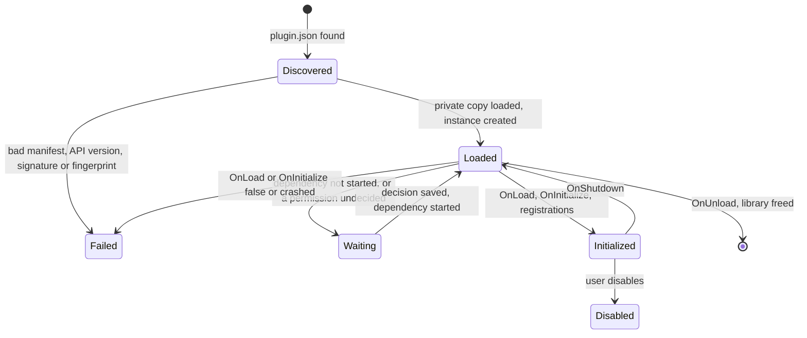

This page is the host side of plugins, for contributors who change the
loader or the registries. To write a plugin, start with the author guides:
[Plugin quickstart](../../sdk/get-started/first-cpp-plugin.md),
[Plugin developer guide](../../extending/plugin-developer-guide.md) and
[Python nodes](../../extending/python-nodes.md).

The Engine has two kinds of extension:

- **C++ plugins**: a folder with `plugin.json` and a shared library, built
  against the Plugin SDK. Code in `cyxwiz-engine/src/plugin/`.
- **Python node bundles**: a `.cyxnode` folder with `node.json` and
  `node.py`. Code in `cyxwiz-engine/src/extension/python/` and
  `core/python_node_*`.

## A C++ plugin's life

1. **Discovery.** `PluginManager::DiscoverPlugins` scans the search paths
   (`plugins/` beside the program, then `%APPDATA%\cyxwiz\plugins` on Windows
   or `~/.cyxwiz/plugins` elsewhere) for folders that hold a `plugin.json`,
   plus the plugin packs active in an installed runtime
   (`runtime/active-plugins.json`). At start, `LoadStartupPlugins` loads only
   the plugins listed to load at start-up in `plugin_startup.json` (beside the
   permission file); the rest load from the Plugin Manager.
2. **Manifest.** `PluginLoader::ParseManifest` reads `plugin.json` into a
   `PluginManifest`: id, name, version, `api_version`, capabilities,
   permissions, dependencies, `library` and `signature`. An id already
   loaded is skipped before its library is touched.
3. **API version.** The plugin's `api_version` must have the Engine's major
   version and a minor version no higher than the Engine's
   (`PluginVersion::IsCompatibleWith`). The Engine provides plugin API
   **1.4** (`PLUGIN_API_VERSION_*` in `plugin_types.h`).
4. **Private copy.** The library and the shared libraries beside it are
   copied to `<temp>/cyxwiz/plugins/<id>/<content key>/` and the copy is
   loaded (`ShadowCopyLibrary`), so the build output is never locked: a
   rebuild can replace it while the Engine runs. Copies no Engine loaded are
   pruned at start.
5. **Signature.** `PluginSignature::Verify` checks an Ed25519 signature from
   the manifest against the SHA-512 of the copy. An invalid signature refuses
   the plugin; a missing one logs `unsigned (no signature in manifest)` and
   loads. No release signing key is compiled in yet, so in practice every
   plugin loads as unsigned.
6. **Build fingerprint.** Before any other plugin code runs, the loader
   calls the exported `CyxwizPluginBuildFingerprint` and compares it with the
   Engine's: SDK and API version, compiler family, standard library, build
   type (debug or release), pointer size and ArrayFire version. Plugins share
   C++ objects with the Engine, so a mismatch would crash; instead the load
   is refused with the differences.
7. **Instance.** `CreatePlugin` and `DestroyPlugin` (exported by
   `CYXWIZ_PLUGIN_ENTRY`) make and free the `IPlugin`. A plugin that declares
   `RequiresPython` and has no library loads as Python-only.
8. **Initialise.** `PluginManager::InitializePlugin` checks dependencies
   (other plugin ids with version constraints, started in topological
   order), asks for undecided permissions, creates the plugin's
   `EnginePluginContext`, shares the ImGui context, then calls `OnLoad` and
   `OnInitialize`.
9. **Register.** The manager asks the plugin for each interface with
   `QueryInterface` (panels, commands, preferences, nodes, trainable tensor
   nodes, training hooks, data providers, analytics providers, simulation and
   environment providers) and adds what it offers to the registries in
   `plugin/registries/`. An offer whose permission the plugin did not
   declare is skipped and the reason listed in the Plugin Manager.
10. **Unload.** `OnShutdown`, the registrations are removed, then `OnUnload`
    and the library is freed. A trainable node's module holds a lease on the
    library, so a model built by the plugin keeps working until it is
    destroyed, even after the plugin is unloaded or a new build installed.

## Permissions

`plugin.json` declares permissions; the Engine sorts them in two groups
(`plugin/security/permission_store.cpp`):

| Granted without asking | Asked once per plugin version |
| --- | --- |
| `GPU`, `DataRegistry`, `Training`, `UIModify` | `FileSystem`, `Network`, `SystemCommands`, `Python` |

Decisions are saved in `plugin_permissions.json` (`%APPDATA%\cyxwiz` or
`~/.cyxwiz`), keyed by plugin id and version, so a new version asks again.
The checks guard the Engine's own APIs: `EnginePluginContext::CheckPermission`
refuses a registration the manifest does not declare. They do not sandbox
the library. A native plugin runs in the Engine's process with the user's
rights and can do anything that process can. Treat a plugin like any
program you install; see [Security](../../security/index.md).

## Crash isolation

Every call into plugin code goes through `security::SafeExecute`
(`plugin/security/safe_execute.h`): C++ exceptions and hardware faults
(access violation, stack overflow) are caught with structured exception
handling on Windows and `sigsetjmp` / `siglongjmp` on Linux and macOS. The
plugin is marked **Failed** with the fault, and the Engine keeps running. It
is a best effort: a plugin that corrupts memory before it faults can still
take the process down.

## The registries

| Registry | Holds | Header |
| --- | --- | --- |
| Extension node registry | Nodes from plugins and Python bundles, shown with the built-in nodes | `core/extension_node_*` |
| Panel registry | Plugin windows, drawn each frame with the Engine's widgets | `plugin/registries/plugin_panel_registry.h` |
| Command registry | Commands for the console and the command palette | `plugin_command_registry.h` |
| Preferences registry | A plugin's Preferences tab | `plugin_preferences_registry.h` |
| Data loader registry | File formats for Data Input (Arrow C stream) | `plugin_data_loader_registry.h` |
| Analytics registry | Data Studio analyses | `plugin_analytics_registry.h` |
| Training hook manager | Callbacks at epoch and batch events | `plugin_training_hook_manager.h` |
| Simulation and environment registries | Simulation nodes and RL environments | `plugin_simulation_registry.h`, `plugin_environment_registry.h` |

Each registry takes its own lock; `PluginManager::RemoveRegistrations`
removes a plugin from all of them.

## Python node bundles

`PythonNodeProvider` lists bundles from `<project>/nodes`, the user's nodes
folder and the `nodes/` folder of each plugin. Listing reads `node.json`
only and never runs code. `Refresh` re-reads a bundle when its files change,
without a restart.

A bundle's code runs only after the user approved that exact code: the
approval stores the bundle id and the SHA-256 of `node.py` in
`node_approvals.json` (`%APPDATA%\cyxwiz` or `~/.cyxwiz`). Editing `node.py`
changes the hash and asks again. Bundles the user creates in the Engine are
approved as they are written. An unapproved bundle's nodes load and save
like any node, but compiling them reports that the code is not approved.

At run time `MakePythonTensorNodeFactory` imports `node.py` under a private
module name that includes its hash, calls `pycyxwiz.nodes.create`, and wraps
the Python object in a C++ module that takes the interpreter lock for every
call. The interpreter is started by the scripting engine on the UI thread,
never by the factory; if Python is not running, the call fails with the
reason and the Engine starts Python. Approval is consent, not a sandbox: an
approved node runs with the user's rights.

## Related

- [Architecture overview](overview.md)
- [Threading and background work](threading.md)
- [Add a node](../add-a-node.md)
- [Plugin API reference](../../sdk/plugin-api-reference.md)
