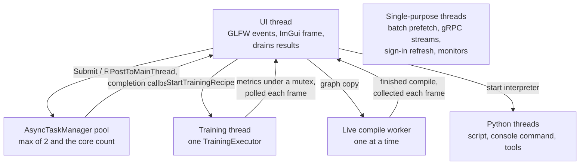

The Engine draws its window on one thread and does everything slow on
others. Most crashes and freezes in this codebase came from breaking the
rules on this page, so read it before you add work that takes more than a
frame.

## The threads

| Thread | Owner | Runs |
| --- | --- | --- |
| UI thread | `CyxWizApp::Run` (`application.cpp`) | Window events, every ImGui call, panel rendering, and the delivery of background results |
| Task pool | `AsyncTaskManager` (`core/async_task_manager.h`) | Data loads, pipeline runs, compiles on request, tests, exports, Studio Debugger runs, plot runs: everything listed in Task View |
| Training thread | `TrainingManager` (`core/training_manager.h`) | One `TrainingExecutor` run. A pool task mirrors its progress in Task View |
| Live compile worker | `LiveGraphCompile` (`core/live_graph_compile.h`) | The compile after each edit. Not a pool task on purpose: one per edit would flood Task View |
| Python threads | `ScriptingEngine` (`scripting/scripting_engine.h`) | Script runs and console commands, each on its own thread |
| Single-purpose threads | Their classes | Batch prefetch (`prefetch_batcher.h`), gRPC streams in `network/`, the sign-in token refresh, system monitors |

## The UI thread

Each frame `CyxWizApp::Update` calls
`AsyncTaskManager::ProcessCompletedCallbacks()`, which runs the completion
callbacks and the work posted with `PostToMainThread`, then
`DatasetCatalog::Pump()`, which delivers dataset changes (added, replaced,
removed) to their subscribers. Then `Render` draws the frame. When nothing
moves, the loop waits for events (idle pacing); a window in the background
draws at 30 frames a second; a minimised window skips drawing but keeps
draining results.

Only the UI thread may:

- call ImGui, ImNodes, ImPlot or OpenGL;
- read or change the node editor's live graph, the panels and dialogs;
- start the Python interpreter;
- replace the graph or close the project.

## The task pool

`AsyncTaskManager::Instance()` is a pool of `max(2, hardware threads)`
workers with a priority queue (Low, Normal, High, Critical). Use
`RunAsync(name, func, progress, completion, owner)` for a function, or
subclass `AsyncTask` for a task with its own state.

- **Progress.** Call `ReportProgress(0..1, message)` from the task. Progress
  shown in Task View never goes backwards.
- **Cancellation is cooperative.** `Cancel` sets a flag; the task checks
  `ShouldStop()` between steps and ends with `MarkCancelled`.
- **Owners.** Bind a task to the panel, editor or project session that
  started it (`owner` argument or `BindOwner`). If the owner is gone when the
  task ends, its completion is dropped on the UI thread instead of reaching
  freed memory. `CancelOwnedBy(owner)` cancels everything an owner started
  when it closes.
- **Shut-down.** `Shutdown(5 s)` refuses new work, retires queued tasks
  without running them, asks running ones to stop, waits up to five seconds,
  then drops every pending callback. A task that ignores cancellation cannot
  block exit; it is named in the log.
- **`RunHere`** runs a function on the calling thread but lists it in Task
  View, for work that must stay on its own thread (the Python worker's
  variable reads).

A finished `LambdaTask` drops its function, so the task history pins no data.

## The frozen-snapshot rule

A worker never reads live editor state. Capture what it needs on the UI
thread and hand over a copy:

- Compile tasks take owned copies of the nodes and links
  (`SubmitGraphCompileTask`); the live compile does the same.
- The Studio Debugger captures its inputs on the UI thread when a run starts
  (`core/studio_debugger_snapshot.h`) and runs on that frozen snapshot.
- A Data Input dialog's Apply snapshots the dialog, loads on a worker into
  a `shared_ptr` state the worker co-owns, and the dialog drains the result
  in `PollAsyncLoadResult` on a later frame. Closing the dialog mid-load is
  safe.
- Code off the UI thread that needs a registry entry takes a copy under the
  registry's lock (for example `DataRegistry::CopyImageDatasetEntry`), because
  a pointer can change or go while it is read.

While a run is active the graph cannot be replaced:
`gui/graph_replacement_policy.h` lists what blocks it (training, testing,
test preparation, data loading before training, a Data Input loading,
simulation, a pipeline run, RL training) and the reason the user sees.

## Training

`TrainingManager::StartTrainingRecipe` refuses a second run, then starts the
training thread with a `TrainingExecutor` and submits a pool task that only
reports the run's progress. The executor publishes metrics under
`metrics_mutex_`; the Training Dashboard reads them each frame. Pause, resume
and stop are flags the executor checks between steps.

- **One run per GPU.** A run on a GPU route takes that device's
  `GpuRunLease` (`core/run_execution_device.h`) on its own thread and holds it
  for its whole life. The lease is a system-wide lock keyed by the GPU's
  physical identity, so runs in two Engines, or an Engine and a test, never
  share a GPU; the second waits and says why.
- **ArrayFire's back end is per thread.** Arrays belong to the back end that
  made them. Code that touches a trained model on another thread (export,
  evaluation) switches to the model's back end first; `TrainingManager`
  records it with the model.

## Python

The interpreter is embedded with pybind11 and started on the UI thread.
Scripts and console commands run on their own threads
(`script_thread_`, `command_thread_`). The Variable Explorer, completion and
debugger tools run one Python function under the GIL, on the caller's
thread, and return JSON. Cancellation uses an atomic flag Python can read
without the GIL. Python nodes take the GIL for each call and release it
after, so a training run with Python nodes serialises on the GIL. Never hold
the GIL while waiting for the UI thread.

## Pipeline runs and plots

A pipeline run is itself a pool task. Inside it, `PipelineExecutor` runs
independent branches at once: a node starts on its own thread as soon as its
inputs are done, up to four at a time, each on its own copy of the run's
context, and the results merge on the run's thread. After a failure or a
cancel nothing new starts. The executor records the dataset names each node
registered under its own mutex, so they can be released when the nodes leave
the graph. The Plot node's result lane (`gui/plot/plot_node_lane.h`)
is UI-thread only: it re-plans twice a second, reads a loaded Data Input
directly, and runs the nodes above a plot through the pool when you press
**Refresh**. An edit above a plot marks it out of date; nothing reruns by
itself.

## Checklist for new background work

1. Snapshot inputs on the UI thread; pass values, not pointers to UI state.
2. Run it through `AsyncTaskManager` so it shows in Task View and can be
   cancelled, unless it is per-frame or per-edit work.
3. Bind it to its owner; deliver results through the completion callback or
   `PostToMainThread`.
4. Check `ShouldStop()` between steps.
5. Touch ImGui and the graph only in the UI-thread callback.

## Related

- [Architecture overview](overview.md)
- [Plugin system internals](plugin-system.md)
- [Add a panel](../add-a-panel.md)
- [Coding standards](../coding-standards.md)
