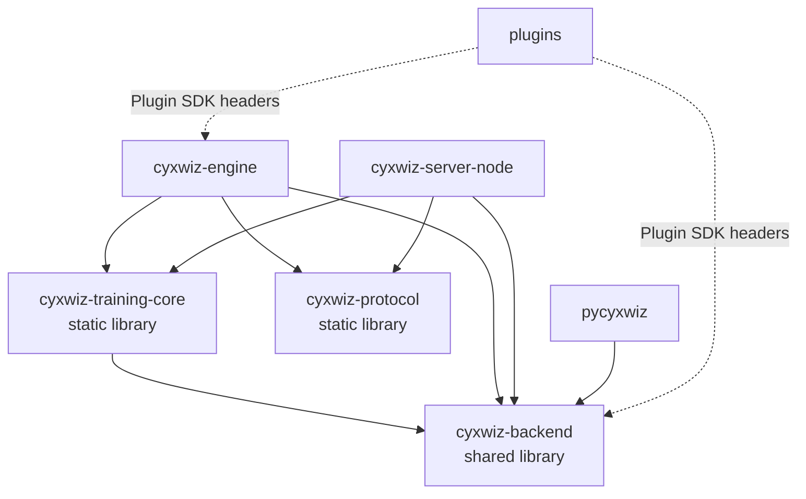

The repository holds the Engine, the shared compute library, the protocol,
the server node, the plugins and their build. This page says what lives
where and which way the dependencies point, so you know where a change
belongs. For how the parts run together, read the
[architecture overview](architecture/overview.md).

## Components and what they own

| Component | Owns | Must not own |
| --- | --- | --- |
| `cyxwiz-backend` | Tensors, computation, layers, models, losses, optimizers, data primitives, devices, neural providers; the `pycyxwiz` Python module | GUI state or network orchestration |
| `cyxwiz-engine` | The desktop app: GUI, graphs, Data Studio, local task orchestration, scripting, plugin host, installer | A second implementation of backend computation |
| `cyxwiz-protocol` | The protobuf and gRPC contracts between processes | Business logic or runtime state |
| `cyxwiz-server-node` | The worker: daemon, GUI and TUI client, job execution, deployment, hardware reporting | The central orchestration service |
| `plugins` | Optional, isolated integrations | Core behaviour or a silent fallback |

The central server and CyxCloud are separate repositories. This repository
holds only the client side of their interfaces (see
[The protocol](protocol.md)).

## Dependency direction

- The backend is the truth for computation. The Engine may translate a graph
  into backend calls but never computes a second way.
- `cyxwiz-training-core` (defined in `cmake/CyxWizTrainingCore.cmake`) is the
  GUI-free compile-and-train path: graph loader and compiler, model builder,
  training and test executors, the batchers, checkpoints and the headless
  graph training job. The Engine and the server node both link it, so a
  remote job trains with the same code as a local one.
- Protocol types carry data between processes; they never become a second
  domain model.
- Plugins see only the Plugin SDK: the Apache-2.0 headers in
  `cyxwiz-engine/src/plugin` and `cyxwiz-backend/include/cyxwiz`, packaged by
  `cmake/CyxWizPluginSDK.cmake`.

## Top-level folders

| Folder or file | Contents |
| --- | --- |
| `cyxwiz-backend/` | `include/cyxwiz/` (public headers, shipped in the SDK), `src/core/` (tensor, device, memory, engine start-up, C API), `src/algorithms/` (layers, losses, optimizers, activations, providers, text, signal, time series, classic ML, clustering, RL), `python/` (pybind11 bindings for `pycyxwiz`), `oneapi/` (SYCL kernels built with DPC++) |
| `cyxwiz-engine/` | `src/` (below), `tests/` (Engine tests, the computation-truth and oracle harness), `python_tools/` (Python helpers the Engine runs: completion, variables, debugger, plot capture), `python/` (examples and requirements), `resources/`, `external/` (vendored ImNodes and others) |
| `cyxwiz-protocol/` | `proto/*.proto` and the CMake that generates C++ from them |
| `cyxwiz-server-node/` | `src/` (daemon, GUI, TUI, job execution, deployment, security), `tests/`, `docs/` |
| `plugins/` | `template/` (the starting point for a C++ plugin), `examples/` (activation nodes, data formats, image nodes, MLflow logger), `simulation/mujoco/`, `assistant/` (experimental) |
| `tests/` | Backend tests: `unit/` (the Catch2 `cyxwiz-tests` executable), `smoke/` (device probes), `benchmarks/` |
| `examples/` | Example graphs (`cyxgraph/`), datasets, Python scripts and nodes, `.cyx` scripts, C API and C++ samples |
| `scripts/` | Maintained automation: `docs/` (docs checks and generators), `checks/` (source and oracle checks), `oracle/` (nightly oracle runner), `arrayfire_probes/` (upstream bug reproducers), `compiler_warnings/`, `sdk/`, `startup/`, `templates/` |
| `redist/` | Release packaging, the setup bootstrapper, GPU pack contracts, notices and their tests |
| `cmake/` | Find modules, the training core, the Plugin SDK, installer targets, build info, release packaging |
| `docs/` | These docs |
| `python-embed/` | Parts of the Windows embeddable Python runtime |
| `config/` | Templates only: the server node configuration and the example private-pattern list. `config/local/` is ignored by git for machine-local settings |
| `vcpkg.json`, `vcpkg-ci.json`, `vcpkg-installer.json`, `vcpkg-ports/`, `vcpkg-triplets/` | Dependency manifests, overlay ports and the Linux triplet |
| `CMakeLists.txt`, `CMakePresets.json`, `build.bat`, `build.sh`, `setup.bat`, `setup.sh` | The build entry points ([Build from source](build-from-source.md)) |

## Inside cyxwiz-engine/src

| Folder | Contents |
| --- | --- |
| `core/` | Everything that is not drawing: project manager, `DataRegistry` and dataset catalog, graph compiler, pipeline and training executors, batchers, checkpoints, async tasks, the Studio Debugger's sessions and traces, the node metadata registry, error codes, Engine settings. Sub-folders: `dashboard/`, `datasets/`, `editor/`, `formats/`, `node_executors/`, `plot/`, `rl/` |
| `gui/` | The main window, the node editor (`node_editor*.cpp`), Properties, dialogs, themes and widgets. Sub-folders: `panels/` (one file set per panel), `data_studio/`, `dialogs/`, `dashboard/`, `plot/`, `patterns/`, `preview/`, `query/`, `annotation/`, `loaders/`, `tutorial/` |
| `data/` | Table wrappers over Arrow (`arrow_data_table`, `data_table`) |
| `plugin/` | The plugin host: loader, manager, context, `registries/`, `interfaces/`, `security/`, `builtin/` |
| `extension/python/` | Python node bundles: provider and factory |
| `scripting/` | The embedded Python engine, script manager, cells, language and variables services, sandbox |
| `network/` | gRPC clients for the central server, the server node and CyxCloud; the dataset file server for remote jobs |
| `auth/` | The sign-in client |
| `inference/`, `serving/` | Local inference contracts and the local inference server |
| `preprocessing/`, `utils/` | Image, text and dataset helpers |
| `installer/` | The installer and GPU pack manager front end |

Many core files come in pairs: a plain `*_presentation.{h,cpp}` model that
tests can use without ImGui, and a thin ImGui renderer in `gui/`. Keep that
split when you add a screen ([Add a panel](add-a-panel.md)).

## Entry points

| Program | Entry | Built by |
| --- | --- | --- |
| `cyxwiz-engine` | `cyxwiz-engine/src/main.cpp`, then `CyxWizApp` in `application.cpp` | `cyxwiz-engine/CMakeLists.txt` |
| `cyxwiz-installer`, `cyxwiz-backend-pack-installer`, `cyxwiz-route-probe` | `cyxwiz-engine/src/backend_pack_manager_main.cpp`, `backend_pack_installer_main.cpp` | `cmake/CyxWizInstallerTargets.cmake` |
| `cyxwiz-server-daemon` | `cyxwiz-server-node/src/daemon_main.cpp` | `cyxwiz-server-node/CMakeLists.txt` |
| `cyxwiz-server-gui` (GUI, and TUI with FTXUI) | `cyxwiz-server-node/src/gui_main.cpp` | `cyxwiz-server-node/CMakeLists.txt` |
| `pycyxwiz` | `cyxwiz-backend/python/bindings.cpp` | `cyxwiz-backend/CMakeLists.txt` |
| Tools | `cyxwiz-graph-compile-check`, `cyxwiz-plugin-check`, `cyxwiz-training-profile` and the benchmarks | `cyxwiz-engine/CMakeLists.txt` |

`cyxwiz-engine --export-code <pytorch|tensorflow|keras|pycyxwiz> <graph>
<out>` writes a graph's generated code without opening a window, and
`--package-smoke` checks an installed package's runtime; both exit after.

## Adding something

1. Find the smallest component that owns it, using the table above.
2. Extend an existing contract before you create a new abstraction.
3. Keep optional capabilities explicit: they fail closed when missing.
4. Add tests at the owning layer and at every boundary you changed.
5. Update the docs page for any behaviour a user or contributor can see.

A new top-level folder needs an owner, a lifecycle, a public purpose and a
build or docs entry point.

## Related

- [Architecture overview](architecture/overview.md)
- [Build from source](build-from-source.md)
- [Tests](testing.md)
