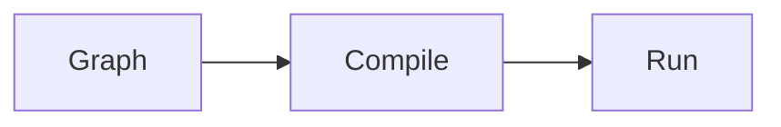

<!-- Explanation template. Context, how it works, trade-offs, limits. No
procedures: link to the how-to pages. Replace every line. -->

## The problem this solves

## How it works

## Design choices

Why it works this way, and what was traded off.

## Limits

## Related
