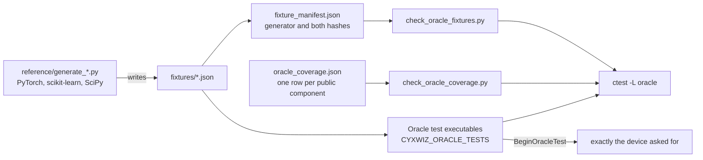

The oracle is the set of tests that compare what CyxWiz computes with a
trusted reference: PyTorch for tensors, layers, losses, optimizers and
training; scikit-learn for metrics, classic ML and text vectorizers; SciPy
for statistics and signals; small in-repo references where no package fits.
It catches silent drift in preprocessing, forward passes, gradients,
optimizer steps and the training loop. For what the results mean to a user,
see [Numerical accuracy](../concepts/numerical-accuracy.md).

PyTorch is a reference, never a runtime dependency of the Engine. The
references run in Python once, write small JSON fixtures, and the fixtures
are committed under `cyxwiz-engine/tests/computation_truth/fixtures/`. The
C++ tests read them; no PyTorch is needed to run the oracle.

## How it fits together



## The three levels

1. **Components.** The `test_computation_truth_*` tests check one family
   each against its fixture: transformer primitives, recurrent layers,
   spatial layers, batch norm, optimizer trajectories, gradient clipping,
   classic ML, clustering, dimensionality reduction, linear algebra, ROC and
   PR, statistical tests, signal, time series, text and text vectorizers,
   word embeddings, data transforms, cross-validation, utilities and PPO.
2. **A model trained against its own PyTorch export.** `test_oracle_train`
   trains small zoo models (an MLP with batch norm, a GRU regressor, a
   transformer encoder classifier, a residual block on image rows, a
   bidirectional LSTM on token ids) for a few steps and compares every step
   with PyTorch running the Engine's own generated PyTorch code for the same
   graph. The export is tested too: the test fails when a fresh export
   differs from the committed one.
3. **A file through the data path.** `test_oracle_data` sends a tabular file
   through Data Input, a scaler fitted on the training split, the batchers
   and the training executor, and compares every row's split, every scaled
   value, each epoch's order and every training step with Python working it
   out without the Engine. Text, series, image, audio and sparse inputs are
   compared batch by batch the same way. It also holds the copy budget: at
   most three scalars read back from the device per training batch, and at
   most two uploads per batch.

The graph training tests in the same list (CNN, Conv1D, Conv3D, branches,
cross attention, linear attention, metric learning, regularisation and
scheduler nodes, the batchers and the training job) are oracle tests as
well.

## Tolerances

| What | Tolerance |
| --- | --- |
| Level 2 training steps (losses and every parameter) | atol 2e-5, rtol 2e-4 |
| Elements no gradient reaches (found by the generator, `noise_mask`) | atol 1e-3 |
| float64-capable devices, analysis features | to the reference in float64, per test |
| float32-only devices (for example Intel Iris Xe) | about 5e-5 relative; iterative and chaotic methods (t-SNE) less closely |

Each test makes sure the comparison can fail: level 2 reruns with the
learning rate times 1.1 and must miss by more than ten tolerances, and the
optimizer cases rerun with epsilon times 10. Dropout in the zoo is 0,
because PyTorch and the Engine draw masks from different generators; masks
are checked on their own by `test_transformer_dropout`.

## Devices

Every oracle test starts with `BeginOracleTest` (`tests/oracle/oracle_test.h`)
and prints two lines:

```text
oracle: test_computation_truth_spatial_layers, commit d40e7b24f...
device: cpu 0 (float64)
```

- `commit` is the commit the binary was built from, so a result from an old
  build tree shows as such.
- `CYXWIZ_TEST_ARRAYFIRE_BACKEND=cpu|cuda|opencl|oneapi` picks the device;
  `CYXWIZ_OPENCL_TEST_DEVICE=N` picks the OpenCL device. The test runs on
  exactly that device or fails. Unset, it says it uses the default device.
- Tests that train pin every run to that device with the Strict policy and
  check at the end that every run used it:
  `training device: every run (N) on arrayfire_cpu 0, strict`.
- Host-only tests (text, utilities, VecNormalize) print `device: host`.

CMake registers each test once per device in `CYXWIZ_ORACLE_DEVICES` as
`oracle_<test>_<device>` with labels `oracle;<device>` (host tests once, as
`oracle_<test>`, labels `oracle;cpu;host`). GPU entries take a lock per
device, so a parallel ctest runs one test at a time on each GPU.

```powershell
cmake --build build --config Release --target cyxwiz-oracle-tests
ctest --test-dir build -C Release -L oracle           # every registered device
ctest --test-dir build -C Release -L oracle -L cuda   # one device
```

## The oracle's own checks

- `oracle_coverage` (`scripts/checks/check_oracle_coverage.py`): reads every
  public layer, module, activation, loss, optimizer and scheduler from
  `cyxwiz-backend/include/cyxwiz`, and the Engine's batchers. Each needs a
  row in `oracle_coverage.json` naming the oracle test, fixture and cases
  that check it, or a named gap with its reason. A new component without a
  row fails; `--write` regenerates `coverage_inventory.json`.
- `oracle_fixture_manifest` (`scripts/checks/check_oracle_fixtures.py`):
  every fixture is listed in `fixtures/fixture_manifest.json` with the
  generator that writes it and the hashes of both. A generator changed
  without its fixture, or a fixture edited by hand, fails.

## Nightly runs on GPU machines

CI runs the oracle on ArrayFire CPU only. `scripts/oracle/nightly_oracle.py`
runs it on a machine's GPUs: it checks out the pushed code into a clone of
its own (never point it at a working tree you use: it is reset), configures
with `CYXWIZ_ORACLE_DEVICES`, builds `cyxwiz-oracle-tests`, runs
`ctest -L oracle` and writes a dated report. With `--live` it also reruns
every generator with the installed PyTorch, scikit-learn and SciPy
(`scripts/oracle/requirements-live.txt`) and lists the fixtures that no
longer reproduce. Schedule it with the system's task scheduler or cron.

## Add a parity case

1. Write or extend a generator in
   `cyxwiz-engine/tests/computation_truth/reference/` that computes the
   reference in PyTorch (or scikit-learn, SciPy) and writes a fixture JSON
   with named cases.
2. Run it with Python 3.12 and commit the fixture.
3. Record it: `python scripts/checks/check_oracle_fixtures.py . --update
   <fixture>.json`.
4. Write the C++ test (or a case in an existing one). Start `main` with
   `BeginOracleTest("<test name>")`, read the fixture from the source root,
   compare with a tolerance, and add a case that must fail (a perturbed
   setting).
5. Add a new executable to `CYXWIZ_ORACLE_TESTS` in
   `cyxwiz-engine/CMakeLists.txt` (and to `CYXWIZ_ORACLE_HOST_TESTS` if it
   uses no ArrayFire device).
6. Add or update the component's row in `oracle_coverage.json`, then run
   `python scripts/checks/check_oracle_coverage.py . --write`.
7. Run `ctest -L oracle` on CPU and on every GPU you have.

To refresh the level 2 and 3 fixtures after changing a zoo model or the
code export, write the exports with `test_oracle_train --write-exports
<fixtures>/train_trajectory` (or `test_oracle_data --write-exports
<fixtures>/data_parity`), rerun the matching generator, then update the
manifest. The folder's `README.md` lists every current test and case.

## Related

- [Tests and checks](testing.md)
- [Compute back ends and neural providers](architecture/compute-back-ends.md)
- [Numerical accuracy](../concepts/numerical-accuracy.md)
