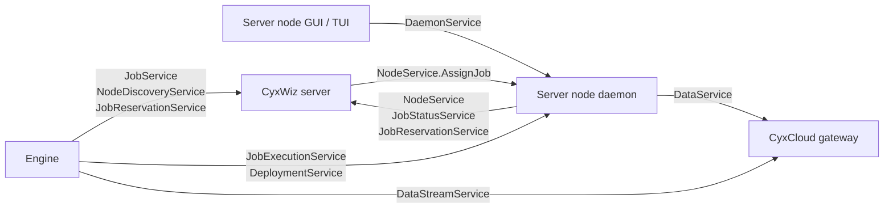

Every message between CyxWiz processes is defined in
`cyxwiz-protocol/proto/` as protobuf with gRPC services. The
`cyxwiz-protocol` static library (`cyxwiz-protocol/CMakeLists.txt`)
generates the C++ for the files in its `PROTO_FILES` list; the Engine and the
server node both link it. This page maps the services. The protocol is
pre-release: fields marked deprecated in the files are on their way out, and
some messages carry fields no current code reads.

## Who talks to whom

Sign-in is not gRPC: the Engine and the node sign in through the CyxWiz
server's HTTP sign-in API and send the token they get with their gRPC calls.

## Services

| File | Package | Service | Served by | Called by |
| --- | --- | --- | --- | --- |
| `common.proto` | `cyxwiz.protocol` | (messages only) | | |
| `job.proto` | `cyxwiz.protocol` | `JobService` | CyxWiz server | Engine (`network/grpc_client.cpp`) |
| `node.proto` | `cyxwiz.protocol` | `NodeService` | CyxWiz server (registration, heartbeat, reports); server node (`AssignJob`, `node_service.h`) | Server node (`node_client.cpp`); CyxWiz server |
| `node.proto` | `cyxwiz.protocol` | `NodeDiscoveryService` | CyxWiz server | Engine (`grpc_client.cpp`) |
| `node.proto` | `cyxwiz.protocol` | `JobStatusService` | CyxWiz server | Server node (`node_client.cpp`) |
| `reservation.proto` | `cyxwiz.protocol` | `JobReservationService` | CyxWiz server | Engine (`network/reservation_client.cpp`), server node (`node_client.cpp`) |
| `execution.proto` | `cyxwiz.protocol` | `JobExecutionService` | Server node (`job_execution_service.h`) | Engine (`network/p2p_client.cpp`) |
| `deployment.proto` | `cyxwiz.protocol` | `DeploymentService`, `TerminalService` | Server node (`deployment_handler.h`, `terminal_handler.h`) | Engine (`network/deployment_client.cpp`) |
| `inference.proto` | `cyxwiz.protocol` | `InferenceService` | Server node (`inference_handler.h`) | Clients of a deployed model |
| `daemon.proto` | `cyxwiz.daemon` | `DaemonService` | Server node daemon (`ipc/daemon_service.h`) | Server node GUI and TUI (`ipc/daemon_client.cpp`) |
| `datastream.proto` | `cyxcloud.datastream` | `DataStreamService` | CyxCloud gateway | Engine (`network/datastream_client.cpp`) |
| `cyxcloud_data.proto` | `cyxcloud.data` | `DataService` | CyxCloud gateway | Server node (`cloud_dataset_fetcher.cpp`) |
| `compute.proto` | `cyxwiz.protocol` | `ComputeService` | none in this repository | none |
| `reservation.proto` | `cyxwiz.protocol` | `P2PTrainingService` | none in this repository | none; the same calls are on `JobExecutionService` |
| `deployment.proto` | `cyxwiz.protocol` | `ModelService` | none in this repository | none |

`datastream.proto` and `cyxcloud_data.proto` are copies of the gateway's own
files. gRPC routes by package and service name, so their package and service
names must stay identical to the gateway's.

## The main calls

**Remote training** (`execution.proto`, Engine to node):

| Call | Purpose |
| --- | --- |
| `ConnectToNode`, `DisconnectFromNode` | Open and close a session with the token the reservation gave |
| `SendJob` | Send the job (`JobConfig` from `job.proto`: the graph and its settings) |
| `StreamTrainingMetrics` | One two-way stream for the whole job. The Engine sends `TrainingCommand` (pause, resume, stop, checkpoint request, new hyperparameters, a new job in the same reservation, the reservation's end or extension, dataset file chunks). The node sends `TrainingUpdate` (progress, checkpoint, completion, error, log lines, and requests for dataset files) |
| `PauseTraining`, `ResumeTraining`, `CancelTraining`, `StartNewJob` | The same controls as explicit calls |
| `DownloadWeights` | Stream the trained weights back |

Dataset files travel on the training stream: the node asks with
`DatasetFileRequest` (dataset name, byte offset to resume from) and the
Engine answers with ordered `DatasetFileChunk` messages carrying the whole
file's size and SHA-256 (`network/dataset_file_server.h` on the Engine,
`remote_dataset_fetcher.h` on the node). A supplied Test input never leaves
the Engine. A dataset that lives in CyxCloud is fetched by the node from the
gateway instead, with an access token the Engine obtained for it.

**Reservations** (`reservation.proto`, Engine and node to the CyxWiz server):
`ReserveNode`, `ExtendReservation`, `ReleaseReservation`, `GetReservation`,
`ListReservations`, `EngineHeartbeat`, `GetActiveReservations` and
`GetReconnectionToken` (to reconnect to a reservation that is still active),
and the end reports `ReportJobCompleteFromNode`,
`ReportReservationEndFromEngine`, `ReportReservationEndFromNode`.
Disconnecting from a node closes the stream but keeps the reservation;
releasing it ends the reservation.

**Nodes** (`node.proto`): the node calls `RegisterNode`, `Heartbeat`,
`ReportProgress`, `ReportCompletion` and `NotifyJobAccepted`; the server
calls the node's `AssignJob`. The Engine finds nodes with `FindNodes`,
`ListNodes` and `GetNodeInfo`.

**Jobs** (`job.proto`): `SubmitJob`, `GetJobStatus`, `StreamJobUpdates`,
`CancelJob`, `ListJobs`, `DeleteJob`.

**Deployment and inference** (`deployment.proto`, `inference.proto`): create,
list, stop and delete deployments and read their metrics; run predictions
with `Infer` and read a model's inputs with `GetModelInfo`. `TerminalService`
opens a terminal session on the node.

**Operator IPC** (`daemon.proto`): status, metrics and log streams, jobs,
deployments, local models, API keys, configuration, resource allocation,
the connection to the CyxWiz server, shutdown and restart, between the
daemon and its GUI or TUI on the same machine.

**CyxCloud** (`datastream.proto`, `cyxcloud_data.proto`): list, create,
verify, share and delete datasets, upload files, create and revoke access
tokens, stream data, and fetch whole files.

## Default ports of the server node daemon

From `cyxwiz-server-node/src/core/backend_manager.h`; each can be changed in
the node's configuration file:

| Port | Service |
| --- | --- |
| 50052 | `JobExecutionService` (Engine connections) |
| 50053 | `TerminalService` |
| 50054 | `DaemonService` (IPC; on `localhost` by default) |
| 50055 | `NodeService` (job assignment) |
| 50056 | `DeploymentService` |
| 50057 | `InferenceService` |
| 8082 | HTTP REST API for deployed models |

The CyxWiz server's gRPC interface listens on 50051 and its sign-in API on
3002 by default.

## Changing the protocol

The Engine, the node, the CyxWiz server and the gateway are released
separately, so old and new versions talk to each other. Keep every change
wire-compatible:

1. **Never renumber or reuse a field.** A field's number is its identity on
   the wire.
2. **Removing a field:** delete it and add `reserved <number>;` and
   `reserved "<name>";` in its place, so nobody reuses it.
   `JobConfig` in `job.proto` shows the pattern.
3. **Adding a field:** use a new number. Readers that do not know it skip
   it, so give it a meaning where its default (zero, empty, false) means
   "not sent".
4. **Do not change a field's type**, or move it into or out of a `oneof`.
5. **Adding an RPC** is compatible; removing or renaming one breaks older
   callers. Mark it deprecated in a comment for a release first.
6. **Keep the gateway's copies identical** to the gateway's files.
7. **Add the file to `PROTO_FILES`** in `cyxwiz-protocol/CMakeLists.txt`, or
   it is not built.
8. Test both sides of a changed call: the server node's
   `test_job_execution_service`, the Engine's network tests, and a protocol
   round trip where you add one.

## Related

- [Architecture overview](architecture/overview.md)
- [Code layout](code-layout.md)
- [The CyxWiz ecosystem](../concepts/ecosystem.md)
