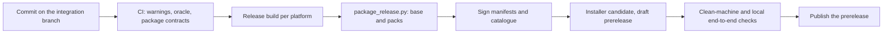

A release is the CyxWiz Installer plus the signed packages it installs: a
CPU base (the Engine, the backend, an embedded Python and the ArrayFire CPU
runtime) and optional GPU packs. This page explains how a release goes from
a commit to a published download. The tooling lives in `redist/` (its
`README.md` has every command and flag) and in `.github/workflows/`.

## Versions and tags

| Version | Where you see it | Example |
| --- | --- | --- |
| Release version | The installer, the docs (`since:`), release notes | `1.0.7` |
| Release tag | GitHub releases; the asset URLs | `cyxwiz-installer-alpha-20261018.1` (date, then a counter for that day) |
| Pack revision | Each GPU pack's manifest; a pack can be updated without a new Engine | `cyxwiz-af-opencl-3.10.0-1` (ArrayFire version, then the pack revision) |

Releases are alpha prereleases. During the alpha, only the latest release
gets fixes. A published tag is immutable: a fix ships as a new tag.

## The pipeline

1. **Continuous checks.** On every push and pull request, the compiler
   warning gate (`compiler-warnings.yml`) builds on Windows, Linux and macOS
   and fails on any warning in CyxWiz-owned source, and the oracle tests
   (`oracle-cpu.yml`) run the parity suites on the ArrayFire CPU back end.
   See [Tests](testing.md).
2. **Release builds.** `cpu-base-native.yml` and `cpu-base-posix.yml` build
   the Release Engine and CPU base per platform from pinned inputs
   (ArrayFire 3.10.0, the Python 3.12 embeddable runtime, pinned CUDA
   redistributable parts for the NVIDIA provider module).
3. **Packaging.** `redist/scripts/package_release.py` (standard-library
   Python, also behind the CMake targets `cyxwiz-package-minimal` and
   `cyxwiz-package-full`) stages each package from declared input folders
   only, never from the developer `PATH`. Profiles:
   - `base`: the Engine, embedded Python, ArrayFire unified and CPU runtime,
     notices;
   - `pack`: exactly one of `cuda`, `opencl` or `oneapi`, with its runtime
     closure from the same ArrayFire installation;
   - `minimal` and `full`: older single-archive profiles, still built.

   Every package gets a `PACKAGE_MANIFEST.json` listing each file's size,
   source and SHA-256. Packaging stops before writing an archive when a
   required file, runtime, licence or notice is missing (for example the
   Intel oneMKL notices, which every Windows full profile needs because the
   ArrayFire CPU runtime includes MKL). `KNOWN_ISSUES.md`, `README.md` and
   the licence files are copied into every package.
4. **Signing.** Pack manifests are signed with Ed25519
   (`sign_pack_manifest.py`), and the signed manifests are assembled into a
   signed catalogue (`prepare_backend_pack_repository.py`) that the
   installer checks against its bundled trust root. New packs are signed as
   `support_status=diagnostic`; `prepare_pack_support_promotion.py` makes a
   new supported candidate after qualification, which is signed again.
   Release keys are kept outside the repository, build trees and packages.
5. **Installer candidate.** `installer-alpha-candidate.yml` (run by hand,
   with the tag, the asset base URL, the release version and the installer
   bundle version) builds the installer for Windows x64, Linux x64 and
   macOS arm64 and x64, and `assemble_installer_alpha_release.py` assembles
   the signed assets into a draft prerelease. Nothing is uploaded or tagged
   by assembly alone.
6. **Verification.** Before publishing, each package is extracted on a
   clean machine with no development ArrayFire or Python on the path,
   launched through its launcher, and a bounded operation is run on every
   back end it advertises, checking that the requested and effective
   device agree and that a missing pack and a missing driver give different
   errors. `redist/CLEAN_MACHINE_MATRIX.md` lists the evidence each
   platform needs. A successful launch proves only that the libraries load.
   The full setup-to-installer flow is also run locally before the release
   workflows.
7. **Publication.** `installer-alpha-publish.yml` downloads the draft,
   verifies the signed inventory and that the GitHub assets are unchanged,
   then publishes it as a prerelease (`--prerelease`, not marked latest).

## What a release ships besides binaries

- **Release notes.** Each user-visible change adds a fragment to
  `docs/release-notes/next/` in the same commit (template
  `docs/internals/docs/templates/release-note-fragment.md`). The release
  assembles them into the notes for its version; the page under
  `docs/whats-new/` is written for users.
- **Known issues.** `KNOWN_ISSUES.md` ships next to `LICENSE` in every
  package, and the docs page [Known issues](../known-issues.md) holds the
  detail. A confirmed bug that ships unfixed is listed before the release;
  its entry is removed when the fix ships.
- **Notices.** The CyxWiz licences, the Apache-2.0 SDK licence and notice,
  and each bundled component's licence (Python, ArrayFire, Intel and NVIDIA
  runtimes, vcpkg ports). Hardware drivers are never bundled.
- **The plugin SDK.** Headers, CMake package and samples, installed with the
  Engine.

## Design choices

- **One packaging implementation.** Shell wrappers, CMake targets and CI all
  call `package_release.py`, so there is one list of runtime files.
- **Fail closed.** A package with a missing notice, runtime or licence is
  not produced at all; a manifest without a signature is a signing request,
  not a publishable artifact.
- **Packs are separate.** GPU runtimes are large and vendor specific, so the
  base runs everywhere and each GPU pack is optional, signed and updated on
  its own.

## Limits

- Self-contained full packages are verified on Windows only; the Unix full
  wrapper refuses until Linux and macOS closures have their own clean-machine
  evidence.
- The Engine does not check for updates itself; users update from the
  installer. See [Update and uninstall](../install/update-and-uninstall.md).

## Related

- [Build from source](build-from-source.md)
- [Tests](testing.md)
- [GPU packs](../install/gpu-packs.md)
