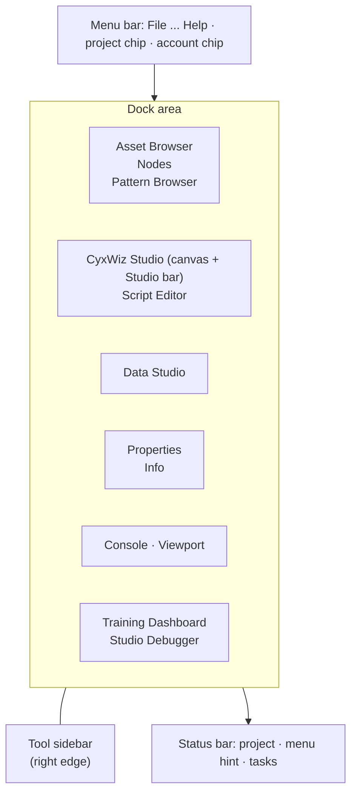

After you open or create a project (or choose **Continue without
project** on the [start page](start-page.md)), the Engine shows its main
window: a menu bar, a dock area full of panels, a tool sidebar and a status
bar.

## The parts

| Part | Where | What it does | Page |
| --- | --- | --- | --- |
| Menu bar | Top | Twelve menus, the open project and your account | [Menus](menus.md) |
| Dock area | Middle | Holds the panels, as tabs and split areas | [Layouts and docking](layouts-and-docking.md) |
| CyxWiz Studio | Centre | The graph canvas where you build a model, with the Studio bar on top | [The Studio bar](toolbar.md), [Graph editor](../user-guide/graph-editor/index.md) |
| Tool sidebar | Right edge (or left) | One icon per panel; click to show or hide it | [The tool sidebar](#the-tool-sidebar) |
| Status bar | Bottom | Project name, menu hints, Python setup, running tasks | [Status bar](status-bar.md) |

## The panels in the default layout

The first launch, and **View > Layout > Reset to Default**, arrange the
panels like this:

| Area | Panels |
| --- | --- |
| Left (about 15 % of the width) | **Asset Browser**, **Nodes**, **Pattern Browser** |
| Centre left | **CyxWiz Studio**, **Script Editor** |
| Centre right | **Data Studio**, with **Table Viewer**, **Annotation Editor**, **Query Console**, **Plot Output**, **Cloud Browser**, **Dataset Manager** and **Plugin Manager** as tabs when you open them |
| Right | **Properties**, and **Info** below it |
| Bottom left | **Console** and **Viewport**, with **Variable Explorer**, **Background Tasks**, **Jobs** and **P2P Training** as tabs when you open them |
| Bottom right | **Training Dashboard**, **Studio Debugger**, **Simulation Monitor** |

Shown at first: CyxWiz Studio, Properties, Nodes, Info, Asset Browser,
Console, Viewport and Data Studio. The others open from **View > Panels**
or the sidebar. After the first session, the Engine reopens the panels that
were open when you closed it.

Some panels have a short name in the menu and a longer window title:

| In **View > Panels** and the sidebar | Window title |
| --- | --- |
| Node Info | Info |
| Patterns | Pattern Browser |
| Training | Training Dashboard |
| Tasks | Background Tasks |
| Jobs | Job Status & Orchestration |
| P2P Training | P2P Training Progress |
| Cloud Manager | Dataset Manager |

## The tool sidebar

A narrow strip of icons, one per panel, on the right edge of the window by
default. The icons are grouped: **Workspace**, **Data**, **Training**,
**Network** and **Extensions**.

- Click an icon to show or hide its panel. A bar beside the icon marks a
  panel that is shown. Hover for its name.
- The icon at the bottom opens the **Command Palette** (Ctrl+P).
- Right-click the sidebar for:
  - **Sidebar side**: **Left** or **Right** (saved for every project; also
    in **Preferences > Appearance**);
  - **Auto-hide**: the sidebar slides away until the pointer nears that
    edge (for this session only);
  - **Hide sidebar**: hides it for this session.

## Panels, tabs and focus

- Panels in the same dock area show as tabs. The active tab has an accent
  bar on top.
- The small menu button on a dock area's tab bar lists its windows and has
  **Close All**, **Hide Tab Bar** and **Show Tab Bar**.
- Whatever you open last comes to the front, also when its window was
  already open behind another tab.
- The CyxWiz Studio tab names the open graph, for example
  **CyxWiz Studio · mnist_mlp**, with a dot while it has unsaved changes.

## The Command Palette

**View > Command Palette...** (Ctrl+P, or the sidebar's bottom icon) lists
every menu command with its shortcut and menu path. Type to filter by name,
path or key; **Up** and **Down** move, **Enter** runs the command, **Esc**
closes the palette.

## Closing the Engine

**File > Exit** (Alt+F4) or the window's close box. When something is
still open, **Close CyxWiz Engine?** lists it (unsaved work, a running
script, datasets in memory) and offers **Save and close**, **Close without
saving** or **Keep working**.

## Related

- [The start page](start-page.md)
- [Editing values](editing-values.md): how fields, steps and pickers work
- [Keyboard shortcuts](../reference/shortcuts.md)
