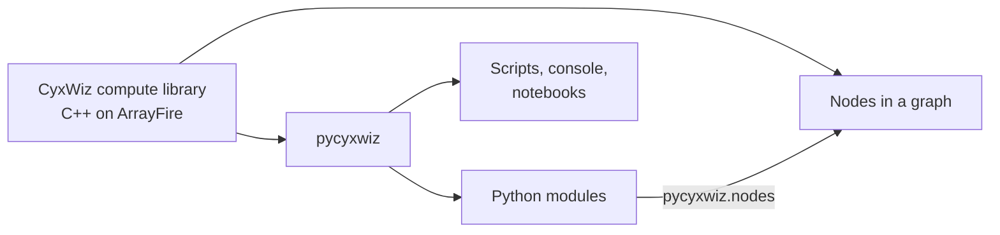

`pycyxwiz` is the Python library of the CyxWiz Engine. It gives Python the
same compute library the Engine's nodes run on: tensors on the GPU or the
CPU, layers, losses and optimizers, a `Sequential` model you train from
code, and numerical tools for linear algebra, calculus and optimization,
signals, statistics, time series and text. Its work runs in C++ on
ArrayFire, on the same device the Engine trains on, not in Python loops.

> Checked against pycyxwiz 0.2.0.

```python
import pycyxwiz as cx

cx.initialize()
print(cx.get_version())          # 0.2.0
x = cx.Tensor.ones([2, 3])
print((x * 2.0).to_numpy().tolist())   # [[2.0, 2.0, 2.0], [2.0, 2.0, 2.0]]
```

## What you can do with it

- **Compute on the device from a script**: create tensors, do arithmetic,
  reductions and reshapes, and move data to and from NumPy.
- **Train a model from code**: build a `Sequential`, run a training loop
  with a loss and an optimizer, predict, evaluate, save the weights.
- **Use the Engine's tools without the window**: the model summary, the
  learning rate range test, explanations and calibration (`pycyxwiz.model`),
  the utilities (`pycyxwiz.utilities`) and the memory figures
  (`pycyxwiz.system`).
- **Do numerical work** in the style of MATLAB: `linalg`, `signal`, `stats`,
  `timeseries`, `calculus` and `optimize`, with NumPy arrays or lists.
- **Write your own nodes**: a `pycyxwiz.Module` written in Python becomes a
  node on the canvas through `pycyxwiz.nodes`.
- **Train on the Engine's environments with other RL libraries**:
  `pycyxwiz.rl` offers a plugin's environments as Gymnasium environments
  ([RL environments](../usage/rl_environments.md)).

## Where it runs

| Where | How pycyxwiz is there |
| --- | --- |
| The Engine's Python console (**Script > Open Python Console**, F12) | Imported when the session starts, as `pycyxwiz` and `cyx` |
| The Script Editor, notebooks and `.cyx` documents | The same session as the console |
| Python nodes on the canvas | The node's code imports it |
| A plain Python 3.12 (a terminal, your editor, a test) | Put the Engine's folder on `sys.path` and its DLL folders on the search path |

The details, and what the Engine prepares for you, are in
[Run in the Engine or standalone](engine-and-standalone.md).

## How it relates to graphs and nodes



A graph and a script use the same library underneath, but they are two ways
in. pycyxwiz does not open, compile or run a `.cyxgraph`: you build the
model in Python instead. The other direction works: a module you write with
`pycyxwiz.Module` can become a node
([Make your first Python node](../sdk/get-started/first-python-node.md)).

## Learn

- [Quickstart](quickstart.md): import, a tensor, a small model on the
  committed handwritten-digits sample, train, predict, in a few minutes.

## Guides

- [Tensors and devices](tensors-and-devices.md): create tensors, data
  types, NumPy, shapes, the GPU and the CPU.
- [Layers, models and losses](layers-models-and-losses.md): `Sequential`,
  the modules, the layer classes, the losses.
- [Optimizers and training loops](training-loops.md): the loop, batches,
  the learning rate, freezing, gradient checks.
- [Work with data](working-with-data.md): NumPy, CSV and Parquet files with
  the DuckDB loader, pandas, and the data the Engine has loaded.
- [Evaluate a model](evaluation-and-metrics.md): accuracy, the confusion
  matrix, ROC, calibration and explanations.
- [Save and load models](saving-and-loading.md): weights files and NumPy
  archives.
- [Maths and optimization](maths-and-optimization.md): linear algebra,
  integrals and derivatives, linear and quadratic programs.
- [Signals, statistics and text](signals-statistics-and-text.md): FFT and
  filters, clustering and PCA, time series, words and sentiment, utilities.
- [Run in the Engine or standalone](engine-and-standalone.md): the session
  the Engine prepares and a plain Python setup.
- [Performance](performance.md): which path is fast and why.
- [Examples](examples.md): the runnable scripts in `examples/python`.

## Reference

- [pycyxwiz API reference](reference/index.md): every function and class,
  generated from the module, one page per part.
- [Tensor operations for nodes](../sdk/tensor-operations.md): the tensor
  operations next to their C++ names.

## Related

- [Script with Python](../user-guide/scripting/index.md): the Script
  Editor, the console, notebooks and the Python environment.
- [Write a module in Python](../sdk/guides/python-modules.md) and
  [Python nodes](../sdk/guides/python-nodes.md): from a class to a node.
