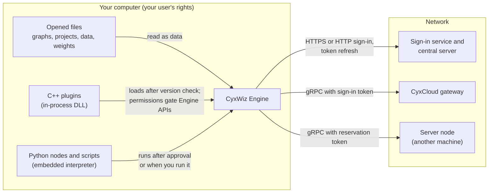

CyxWiz Engine is a desktop program that runs as you. Anything it loads with
code in it (a C++ plugin, an approved Python node, a script you run) runs
with your user's rights: it can read and change your files and use the
network. The Engine checks what it can before such code runs, but it does
not sandbox it. Treat plugins, Python bundles and scripts like any program
you download.

Files that hold only data (graphs, projects, datasets, model and weight
files) are read as data. Opening them does not run code.

## Trust boundaries

| Boundary | What is checked today | What is not |
| --- | --- | --- |
| Opened files | Each format is parsed as data. PyTorch weight files are read by a data-only pickle reader that refuses anything other than a plain state-dict. | Damaged or hostile data can still make a load fail. |
| C++ plugins | The plugin must be built the way this Engine was (build fingerprint). You approve its dangerous permissions once per version. Crashes in plugin callbacks are caught. | The plugin is native code in the Engine's process: its own code is not limited by the permissions, and signatures cannot be verified yet. |
| Python nodes (`.cyxnode`) | Their code runs only after you approve that exact code (bundle id and SHA-256 of `node.py`). | Approved code runs with your rights. |
| Python scripts and the console | Nothing runs until you run it. | The optional Script Editor sandbox is a guard against mistakes, not a security boundary. |
| Network to the CyxWiz services | Sign-in tokens, short-lived, renewed in the background. | Addresses you set yourself may be plain `http://`. |
| Remote jobs on a server node | Each Engine connection must carry a reservation token the node verifies. | Jobs run inside the node's daemon, not in a container. |

The details of each row are in
[Plugins, Python nodes and opened files](untrusted-files-and-plugins.md).
Operators of a server node: read
[Harden a server node](server-node-hardening.md).

## What leaves your computer

The Engine sends nothing on its own: no telemetry, no update check, no crash
upload. It contacts a server only when you sign in, use a cloud or remote
feature, or use a plugin that downloads. The exact list is in
[What CyxWiz sends over the network](../about/privacy.md).

## Limits

- No plugin can be verified as signed by CYXWIZ today: the Engine's
  signature key is not set, so every plugin loads as unsigned.
- Nothing the Engine runs is isolated from your account. Use a separate user
  account or a virtual machine to try code you do not trust.
- The server node's limits (unauthenticated services, no job container) are
  listed in [Harden a server node](server-node-hardening.md#limits-today).

## Report a problem

Found a vulnerability? Do not open a public issue. See
[Report a vulnerability](report-a-vulnerability.md).

## Related

- [Plugins, Python nodes and opened files](untrusted-files-and-plugins.md)
- [Harden a server node](server-node-hardening.md)
- [What CyxWiz sends over the network](../about/privacy.md)
