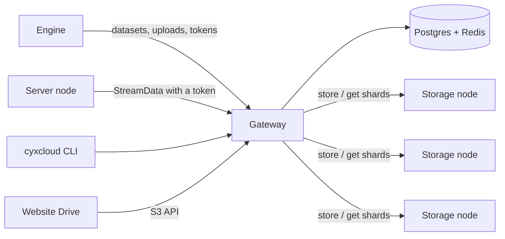

## The pieces

| Crate / process | Role |
| --- | --- |
| `cyxcloud-gateway` | The manager, and the only thing clients talk to. Owns the catalogue, splits and encodes files, places shards on nodes, rebuilds files on read, issues dataset access tokens, and serves the S3 API, the dataset REST API and three gRPC services (`NodeService`, `DataService`, `DataStreamService`). One per cloud. |
| `cyxcloud-metadata` | The gateway's memory: Postgres tables for users, buckets, files, chunks, chunk locations, nodes, datasets, access tokens and shares; a Redis cache; the placement engine. A library inside the gateway. |
| `cyxcloud-node` | A storage node: holds shards on its disk, serves store-shard and get-shard over gRPC to the gateway, registers and heartbeats with the gateway, and signs in to the CyxWiz API as a machine. |
| `cyxcloud-rebalancer` | Runs inside the gateway. Every 60 s (`REBALANCER_SCAN_INTERVAL_SECS`) it looks for shards with fewer copies than the target (`REBALANCER_REPLICATION_FACTOR`, default 1: one copy per shard is complete, because a lost shard is rebuilt from parity on read) and plans moves or repairs. What it cannot repair it reports once per scan. |
| `cyxcloud-network` | Node-to-node shard transfer over gRPC. Nodes find each other through the gateway's node registry, not peer to peer. |
| `cyxcloud-protocol` | The `.proto` files: `node.proto`, `data.proto` (stream one whole file), `datastream.proto` (datasets, tokens, upload, delete). The Engine compiles verbatim copies. |
| `cyxcloud-cli` | The `cyxcloud` command. |

## Who is a client, who joins

Clients never hold data for others:

- **The Engine** lists datasets, uploads files, creates datasets and mints
  access tokens.
- **A server node** streams one file with a token when it trains.
- **The website's Drive** uses the S3 API with the signed-in user's token;
  each user has one bucket and reaches only that one.
- **The `cyxcloud` CLI.**

Joining the storage means running `cyxcloud-node`. The gateway is the
manager; storage nodes are the members; everything else is a client.

## What happens to a file

1. An upload reaches the gateway, which records the file with its BLAKE3
   content hash.
2. The file is cut into 4 MB chunks. Each chunk is Reed-Solomon encoded into
   10 data shards plus 4 parity shards.
3. The placement engine picks an online node per shard: the node that holds
   the fewest shards of that chunk so far, ties broken by the best score
   (least used storage, nearness to the uploader when known, datacenter and
   rack diversity, bandwidth). The gateway pushes the shards out.
4. A read fetches at least 10 of the 14 shards per chunk. Every shard's
   bytes must hash to its id: a node that answers with other bytes is
   skipped, counted against and logged, and the shard is taken from
   another node. The rebuilt file must hash to what was recorded at upload,
   or the read fails with a clear error. A node refuses to serve a stored
   shard that no longer hashes to its id (`DATA_LOSS`).
5. While enough shards survive, reads work: the gateway rebuilds missing
   shards from parity on every read. The rebalancer lists shards with no
   live copy, but it does not yet rebuild a lost shard onto another node,
   so each further loss brings a chunk closer to unreadable.

What a node loss costs: a chunk needs any 10 of its 14 shards. With one
node everything is on it; with two, each holds 7, so losing either makes
every file unreadable until it is back (`DATA_LOSS: not enough shards are
held by online nodes (have 7, need 10)`). From four nodes on, no node holds
more than 4 shards of a chunk, and one node can be lost without losing
data. A node that restarts keeps its identity, so its shards stay its own.

## Who a node is

- **Identity.** On first start a node makes an Ed25519 key at
  `~/.cyxcloud/node/key` (owner-only). Its node id is derived from the
  public key, so it cannot be chosen or copied: a registration carries the
  public key and a signature over the node id, its listen address and a
  timestamp (300 s of clock skew allowed), and the gateway accepts a known
  id only with the key it was registered with.
- **Registration limit.** The gateway accepts at most 5 new node ids per
  client address per hour; over it, `RESOURCE_EXHAUSTED`. A restart of a
  known node is not counted. When the count cannot be read (Redis down),
  new nodes are refused (`UNAVAILABLE`).
- **Client address.** Behind the gateway's own proxies, its limits use the
  `X-Forwarded-For` entry the outermost proxy appended
  (`TRUSTED_PROXY_HOPS`, 1 behind the front door); entries a client wrote
  are ignored. Without the setting the header is ignored.
- **Node token.** Registration answers with a node token; heartbeats,
  metric reports and drains must carry it and act only on that node. A
  user's sign-in is refused for node calls.
- **Access secret.** The node also makes `~/.cyxcloud/node/access_secret`
  and gives it to the gateway at registration. Every shard call to the node
  must present it as `authorization: Bearer <secret>`; anything else is
  refused with `UNAUTHENTICATED` before storage is touched. The node's own
  port has no TLS yet, so the secret travels in clear on the network.

## Token types

Every token the gateway issues carries `typ`: `access` (1 hour), `refresh`
(7 days), `node` (24 hours) or `api_key` (`expires_in_days`, 1 to 365,
default 90).

- A refresh token is accepted only by `POST /api/v1/auth/refresh`, which
  answers a new access token.
- A token without `typ` is refused: sign in again or create a new API key.
  A token without a `jti` is accepted only from the CyxWiz sign-in API, as
  an access token.
- `POST /api/v1/auth/api-keys` takes a user's access token and must name
  the key's permissions: `storage:read`, `storage:write`, `storage:delete`,
  `dataset:read`, `dataset:write` (no wildcard, no node rights). Every route
  checks them for an API key.
- A dataset access token (`CreateAccessToken`, used by `StreamData`) lives
  at most 24 hours, never past the API key that asked for it, with the
  scopes `read` or `stream` only.
- `POST /api/v1/auth/logout` revokes the token it is called with and, given
  `{"refresh_token": ...}` of the same user, that refresh token too.
  Logging out with an API key revokes the key.

## Node maintenance

An administrator can hold a storage node in **maintenance**. A held node
takes no new shards and is never a placement or repair target; while it
heartbeats it still serves the shards it holds. It stays held across
restarts until an administrator releases it.

## Known limits

- The gateway is the single manager and the single data path: every byte
  passes through it.
- Fewer than four storage nodes cannot survive a node loss, and the
  rebalancer does not yet repair lost shards onto other nodes.
- Node-to-node transfer exists as code; the gateway does not route through
  it.
- Node registration is signed and limited per address but not tied to an
  account; a host with many addresses can register many nodes.
- Shard traffic to storage nodes is not encrypted.
- Shards are not encrypted on the client side: a storage node holds pieces
  of other people's files (never a whole file).
