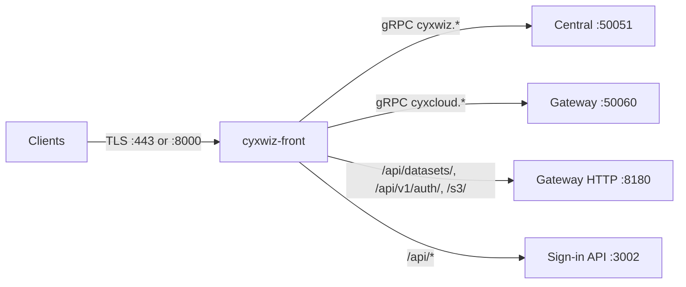

The front door (`cyxwiz-front`, in the CyxCloud repository) gives the whole
CyxWiz server side one address. Every client (the Engine, the `cyxcloud`
CLI, storage and server nodes, the website) talks to the front door; the
front door talks to the services on a private network.



## Run it

```bash
JWT_SECRET=... ADMIN_JWT_SECRET=... cyxwiz-front --config front.toml
```

Without a config file it listens on `[::]:8000` (every IPv4 and IPv6
address, so `http://localhost:8000` works where `localhost` is `::1`
first), plain HTTP, and routes to the services on this machine. Clients
then use `http://HOST:8000`; with TLS (below), `https://HOST`.

## What it does to every request

| Step | Rule |
| --- | --- |
| Limit | At most `requests_per_minute` (default 1200) per client address: the connection's, or `CF-Connecting-IP` when the connection comes from a `trusted_proxies` address. Over it: HTTP 429 / gRPC `RESOURCE_EXHAUSTED`. |
| Route | gRPC by package, HTTP by path prefix; the longest prefix wins. Nothing else is served (404 / `UNIMPLEMENTED`). |
| Sign-in | A request with `Authorization: Bearer` must carry a valid, unexpired token signed with `JWT_SECRET` or `ADMIN_JWT_SECRET`, or it gets 401 / `UNAUTHENTICATED` and never reaches the service. A request without a token goes through and the service decides (sign-in, node registration and dataset streams need none). The services check tokens again. |
| Size | An HTTP body over `http_body_bytes` (default 16 MB) is refused (413). gRPC streams are left to the services. |
| Forward | gRPC over HTTP/2, HTTP over HTTP/1.1; streams and trailers pass through; `X-Forwarded-For` gets the client address appended, `-Proto` and `-Host` are added. A service that does not answer: 502 / `UNAVAILABLE`. |
| Audit | One log line per request (target `audit`): client address, listener, method, path, route, status, account, milliseconds. Never a token. |

`/s3/` reaches the gateway's S3 API (the website's Drive) with its own body
cap of 256 MB; the gateway serves only the signed-in user's own bucket.

Not routed, on purpose: every service's `/metrics` and `/health`, the
gateway's `/ws`, and the central server's REST interface.

`GET /health` is the door's own:
`{"front":"ok","services":{"central":"up","gateway":"up","api":"up"}}`, or
503 when a service does not accept a connection. `cyxcloud doctor` and the
Engine's **Preferences > Servers** read it.

## front.toml

```toml
listen = "[::]:443"                            # "0.0.0.0:443" for IPv4 only
tls_cert = "/etc/cyxwiz/front/fullchain.pem"   # both or neither
tls_key  = "/etc/cyxwiz/front/privkey.pem"
internal_listen = "0.0.0.0:8000"               # with TLS only: plain, for the server's own services; never publish it
trusted_proxies = ["127.0.0.1"]                # for example a tunnel daemon on this machine
client_ip_header = "cf-connecting-ip"

[limits]
requests_per_minute = 1200
http_body_bytes = 16777216

[[route]]
name = "central"
prefix = "/cyxwiz."
upstream = "http://central:50051"
grpc = true

[[route]]
name = "gateway"
prefix = "/cyxcloud."
upstream = "http://gateway:50060"
grpc = true

[[route]]
name = "gateway"
prefix = "/api/datasets/"
upstream = "http://gateway:8180"

[[route]]
name = "gateway"
prefix = "/api/v1/auth/"
upstream = "http://gateway:8180"

[[route]]
name = "gateway"
prefix = "/s3/"
upstream = "http://gateway:8180"
body_bytes = 268435456        # this route's cap in place of http_body_bytes

[[route]]
name = "api"
prefix = "/api/"
upstream = "http://api:3002"
```

Without `[[route]]` entries the door uses these routes to the services on
this machine. `body_bytes` is for HTTP routes only; a gRPC route with it is
refused. Unknown keys are refused too, so a typo does not silently change
the door.

With `tls_cert` and `tls_key`, the `listen` port speaks TLS only (HTTP/2
and HTTP/1.1 by ALPN). `internal_listen` is a second, plain listener with
the same routes, sign-in check, limits and audit, for the server's own
services (a health check, the website calling the door). Publish only
`listen`. See [TLS](tls.md).

## Not there yet

- Limits shared across several doors, and per-account quotas.
