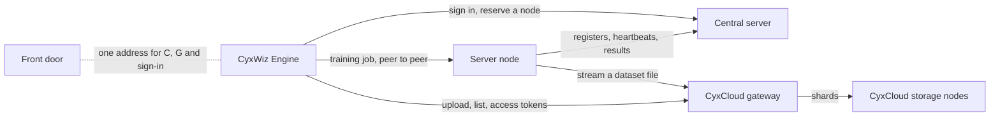

The Engine trains on your computer without any server. The pages in this
section are for the optional server side: renting another machine to train
on, storing datasets in CyxCloud, and running those machines yourself.

> **Experimental.** Remote training is not ready for public use. A server
> node accepts some jobs without checking who sent them and runs every job
> inside its own process, with no sandbox. Run server nodes only on machines
> and networks you control. See [Security notes](security.md).

## The parts

| Part | What it does | Who runs it |
| --- | --- | --- |
| **Server node** (`cyxwiz-server-daemon` and `cyxwiz-server-gui`) | Lends a machine's CPU or GPU: takes training jobs from the Engine, serves deployed models | Anyone who lends a machine |
| **Central server** | Keeps the list of server nodes, takes reservations, issues the tokens the Engine shows a node, and records job results | CyxWiz (closed source; this documentation describes only its role and the addresses clients use) |
| **Sign-in service** | CyxWiz accounts: the Engine, the server node GUI and the `cyxcloud` CLI sign in here | CyxWiz |
| **CyxCloud gateway** | The storage network's manager: datasets, uploads, access tokens, and file streams to training nodes | CyxWiz, or you for a private cloud |
| **CyxCloud storage node** | Offers disk space; holds erasure-coded shards of other people's files | Anyone who lends disk space |
| **Front door** (`cyxwiz-front`) | One address, with TLS, in front of central, the gateway and sign-in | Whoever runs the server side |

Every client finds the server side through one
[server address](server-address.md).

## Pages in this section

Server nodes:

- [Server node](server-node/index.md): what a node is and its two programs.
- [Build and install a server node](server-node/install.md)
- [Run a server node](server-node/run-a-server-node.md): check, start, and
  how a reserved job runs.
- [Sign in to a server node](server-node/sign-in.md)
- [Server node settings](server-node/settings.md): the GUI's pages and the
  `server_config.yaml` keys.
- [Server node HTTP API](server-node/http-api.md): serving deployed models.
- [Datasets from CyxCloud on a node](server-node/cloud-datasets.md)
- [Temperature and power on macOS](server-node/macos-sensors.md)

CyxCloud:

- [CyxCloud](cyxcloud/index.md): the storage network and its pages.

For every server:

- [The server address](server-address.md): one address for central,
  CyxCloud and sign-in, and private certificate authorities.
- [Ports](ports.md): every port the Engine, a server node and CyxCloud open
  or dial.
- [Security notes](security.md): what is and is not protected today.

Training on other machines is in
[Distributed training](../distributed-training/index.md).
