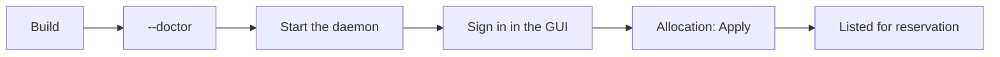

A server node lends a machine's compute to CyxWiz. It registers with the
central server under your account; a user who reserves it in the Engine then
sends training jobs straight to it, peer to peer. A node can also serve
deployed models over HTTP.

> **Experimental.** Server nodes are not in the release packages: you build
> them from source. Their network services are not all authenticated and
> jobs run without a sandbox. Read [Security notes](../security.md) before
> you open a node's ports to anyone.

## Two programs

| Program | What it does |
| --- | --- |
| `cyxwiz-server-daemon` | The node itself: runs jobs, talks to the central server and to the Engine, serves deployed models. Runs without a window. |
| `cyxwiz-server-gui` | The window you use to sign in, choose what to lend, and watch jobs. It controls the daemon over a local connection (`localhost:50054`). |

One daemon runs per machine. A second one refuses to start because the
first already owns the node's ports.

## The path to a running node

1. **Build** the daemon and the GUI. [Build and install a server node](install.md)
2. **Check the machine** with `--doctor`, then start the daemon with the
   P2P secret. [Run a server node](run-a-server-node.md)
3. **Sign in** in the GUI with your CyxWiz account. [Sign in](sign-in.md)
4. **Choose what to lend** on the **Allocation** page and press **Apply**.
   The node registers and starts its heartbeat.

## Pages

- [Build and install a server node](install.md)
- [Run a server node](run-a-server-node.md)
- [Sign in to a server node](sign-in.md)
- [Server node settings](settings.md)
- [Server node HTTP API](http-api.md)
- [Datasets from CyxCloud on a node](cloud-datasets.md)
- [Temperature and power on macOS](macos-sensors.md)
- [Ports](../ports.md) and [Security notes](../security.md)
