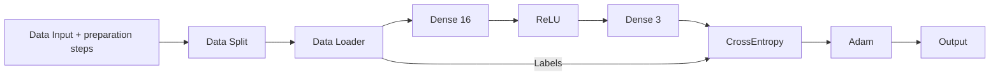

In this lesson you build a model with your own hands: a small classifier
that predicts the `diagnosis` of lesson 3's table from its five features.
You find each node, place it, link it, set its properties and compile until
the graph is ready to train.

The graph you build:

**You need:** the `patients` graph from [lesson 3](prepare-your-own-data.md),
about 20 minutes. The finished graph, for comparison, is
`examples/cyxgraph/missing_values_fix.cyxgraph`.

If you skipped lesson 3, start from an empty canvas: in **Data Studio >
Bring in**, select **Add Data Input...**, pick
`examples/datasets/patients_missing.csv`, use the rows as **Table** with
**Label column** `diagnosis`, and select **OK**. Part 6 then deals with the
missing values.

## 1. Add the data nodes

1. Open the `patients` graph: on the Studio bar, open the graph's button,
   select **Load...** and pick `cyxgraph/patients.cyxgraph`.
2. In the **Nodes** panel, click the search box (**Search nodes (/)**) and
   type `split`.
3. Drag **Data Split** onto the canvas, to the right of the last
   preparation step (the end of the row that starts at the Data Input).
4. Search for `loader` and drag **Data Loader** to the right of the Data
   Split.

## 2. Add the model nodes

Use a different way to add each kind, to learn them:

1. **Dense**: right-click empty canvas to the right of the Data Loader,
   choose **Add Node**, type `dense` in its **Search nodes...** field and
   pick **Dense**. It lands where you right-clicked.
2. **ReLU**: click the canvas's **Search nodes...** box at the top right,
   type `relu` and press **Enter** when **ReLU** is first in the list.
3. A second **Dense**: in the Nodes panel, double-click **Dense**.
4. **CrossEntropy / Token CE**, **Adam** and **Output**: from the Nodes
   panel, by search and drag, or double-click.

Arrange them in a row, left to right, in the order of the drawing at the top of this page:
drag a node by its title bar.

## 3. Connect the nodes

A link runs from an output pin (the circle on a node's right edge) to an
input pin (on the next node's left edge).

1. Drag from the output pin of the last preparation step to the **Data
   Split**'s first input, **Training Dataset**.
2. Data Split **Partitions** to Data Loader **Partitions**.
3. Data Loader **Data** to the first Dense's **Input**; that Dense's
   **Output** to ReLU; ReLU to the second Dense; the second Dense to the
   loss's **Logits**.
4. Data Loader **Labels** (its second output) to the loss's **Labels**.
5. The loss's **Loss** to Adam's **Loss**; Adam's output to Output.

If a link snaps back, it was refused: two outputs or two inputs, types
that do not match, or an input that already has its one link. Hover a pin
to see its name and type. To remove a link, hold **Ctrl** and drag its
input end onto empty canvas. Every rule is in
[Connect nodes](../user-guide/graph-editor/connect-nodes.md).

## 4. Set the properties

Click each node and set it in **Properties**, or in its dialog where it
has one (double-click it):

| Node | Set | Why |
| --- | --- | --- |
| **Data Split** | Keep 0.8 / 0.1 / 0.1, **Stratified** on, seed 42 | 80 % to train, 10 % to pick the best epoch, 10 % to test |
| **Data Loader** | **Epochs** `20` on the **Training** tab; keep **Batch size** 32 | About 235 training rows need more passes than 10 |
| First **Dense** | **Units** `16` | A small hidden layer for five features |
| Second **Dense** | **Units** `3` | One score per diagnosis class |
| **Adam** | **Learning Rate** `0.01` | Faster learning on unscaled features |
| **Output** | **Num Classes** `3` | Three classes, not the default 10 |

Optional: right-click a node and choose **Rename...** to give it a clearer
name, such as `Classes (3)` for the second Dense.

A value differs from its default when the row shows a reset arrow. Every
field kind is described in [Editing values](../main-window/editing-values.md).

## 5. Compile

1. Press **F7**. The compile report opens.
2. If the verdict is **Not ready to train**, read **Findings**. Each
   finding names its node; **Show on canvas** jumps to it. Fix it, then
   press **F7** again.
3. When the verdict is **Ready to train**, open **Configuration**: the
   input per sample is 5 values, and the output 3 classes.
4. Select **Close**, then press **Ctrl+S** with the canvas focused.

To see the report catch a mistake, remove the **Labels** link into the
loss (hold **Ctrl** and drag its end at the loss onto empty canvas) and
press **F7**: the report lists an error on the loss. Link it again.

## 6. Train once

1. Press **F5**.
2. If you skipped lesson 3, **Cannot start training** reports the missing
   values with a card for the feature columns and one for the label.
   Select **Fix and train**: it fills the features with their mean over
   the training rows, drops the rows without a label, and trains.
3. The Training Dashboard shows the run. With so few rows the accuracy
   moves in steps; this lesson is about building, lesson 5 about reading results.

## Next steps

- Lesson 5: [Train, evaluate and understand the results](train-and-evaluate.md)
- Every way to add a node: [Find and add nodes](../user-guide/graph-editor/find-and-add-nodes.md)
- Pins and refused links: [Connect nodes](../user-guide/graph-editor/connect-nodes.md)
- Properties, dialogs and presets: [Set node properties](../user-guide/graph-editor/node-properties.md)
- Each finding's code: [Error messages](../reference/error-messages.md)
