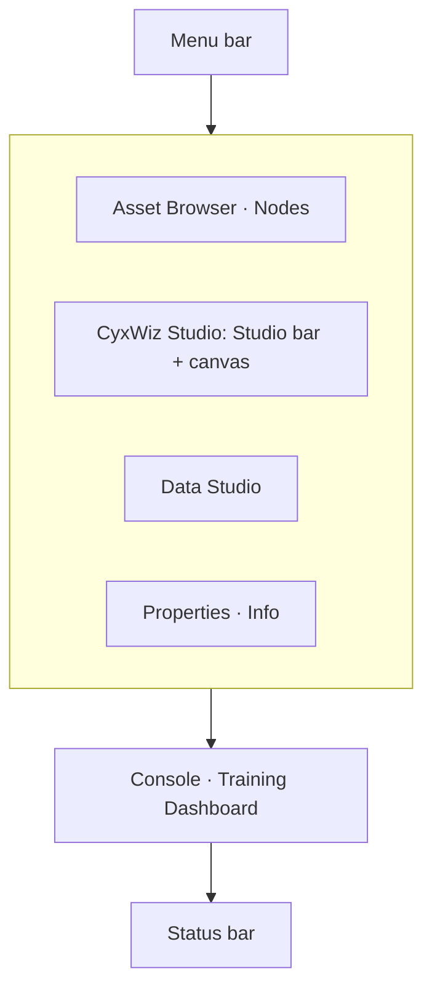

In this lesson you create a project for the tutorials, put a working graph
on the canvas and find your way around the window: where you build, where
you set things, where the data and the results show, and where the Engine
tells you what it is doing.

**You need:** CyxWiz Engine 1.0.8 or later with its `examples` folder (see
[Get the examples](index.md#get-the-examples)), about 10 minutes.

## 1. Create a project

A project is a folder that keeps your graphs, scripts, exports and
checkpoints together. The later lessons save into it.

1. Start the Engine. The start page, **Get started**, fills the window.
2. Look at the chip at the top right. It says whether the Engine found a
   Python for scripting. Graphs build and train without one, so you can
   ignore it until the Python lesson.
3. In the right column, select **Create a new project**. The **Create a
   new project** dialog opens on the **Blank project** template.
4. In **Name**, type `cyxwiz-tutorials`. Leave **Location** as it is
   (`Documents/CyxWiz Projects`); **Creates** shows the folder it will make.
5. Select **Create**.

The main window opens on your new project, with an empty canvas in the
middle.

## 2. Put a graph on the canvas

1. In the middle of the canvas, under **Start a graph**, select **Open an
   example graph**.
2. Choose **Multiclass image classification**.

A row of nodes appears, from **Data Input** on the left to **Output** on the
right. It opens as *Untitled graph*, so the example file is never
overwritten. Press **F** (with the canvas focused) to fit all the nodes in
view.

## 3. Find the parts of the window

Look at each part in turn.

1. **The menu bar** at the top: **File**, **Edit**, **View**, **Nodes**,
   **Train**, **Data** and more. The right end shows the open project.
2. **CyxWiz Studio**, the canvas in the middle, is where you build graphs.
   Its tab names the open graph. Drag empty canvas to move around; turn the
   mouse wheel to zoom.
3. **The Studio bar** on top of the canvas holds the graph's button,
   **Save**, the run mode and, at the right, **Compile**, **Local Debug**
   and **Train**. When the canvas is narrow, some of them move into
   **More**; **Train** always stays.
4. **Nodes**, on the left, lists every node by group. Click a card once and
   **Info** shows what it does; double-click it to add it to the canvas.
5. **Asset Browser**, on the left, shows the project folder. You will see
   your saved graphs under `cyxgraph` and exported models under `exports`.
6. **Properties**, on the right, shows the selected node. Click the first
   **Dense** node on the canvas: Properties shows its **Units** (128).
7. **Data Studio**, the tab beside CyxWiz Studio, is where you look at and
   prepare data. Lesson 3 works there.
8. **Console**, at the bottom, shows the log and takes commands. The
   **Training Dashboard** opens at the bottom right when you train.
9. **The status bar** at the very bottom shows the project, a hint for the
   menu item under the pointer, and running tasks.
10. **The tool sidebar**, a strip of icons on the right edge, shows and
    hides panels. Hover an icon for its name; click it to hide its panel,
    and again to show it.

## 4. Find a command by name

1. Press **Ctrl+P**. The **Command Palette** opens.
2. Type `compile`. The list shows **Compile Graph** with its key (**F7**)
   and its menu.
3. Press **Esc** to close the palette without running anything.

Every menu command is in the palette, so it is the quickest way to find
something you have seen once.

## 5. Put the layout back

If you closed or moved panels while exploring, choose **View > Layout >
Reset to Default**. The panels go back to where they were at the first
launch.

You now know where to build (CyxWiz Studio), where to set a node
(Properties), where to find nodes (Nodes), where data work happens (Data
Studio) and where runs report (Training Dashboard, Console, status bar).

## Clean up

Nothing to remove. Leave the Engine open with the starter on the canvas:
lesson 2 starts from it.

## Next steps

- Lesson 2: [Train your first model from a starter graph](first-model-from-a-starter.md)
- Every part of the window in detail: [The main window](../main-window/index.md)
- The start page and project templates: [The start page](../main-window/start-page.md)
- Arrange panels your way: [Layouts and docking](../main-window/layouts-and-docking.md)
