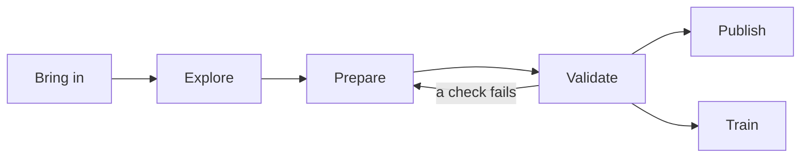

Data Studio is where the open graph's data work happens: you bring a file
in through a Data Input node, look at it, prepare it with a recipe of steps,
check it, and write the result. Everything you do there is a node of the
graph, so training reads exactly what you prepared.

## The path from a file to training

1. **Bring in.** Add a Data Input node and load your file or folder.
   [Bring data into Data Studio](bring-in-data.md)
2. **Explore.** Query it, profile its columns, find gaps and outliers, plot
   it. [Explore a dataset](explore.md)
3. **Prepare.** Clean, filter, join and scale it with the steps of a
   Preparation Recipe. [Prepare data with a recipe](prepare.md)
4. **Validate.** Check row counts, values and the splits before training.
   [Check a dataset before training](validate.md)
5. **Publish.** Optional: write the prepared table to a file with its
   lineage. [Write the prepared dataset](publish-a-dataset.md)
6. **Train**, then read the model's results in Data Studio's **Results**
   job. [Read test results](../evaluation/test-results.md)

## Pages in this section

- [The Data Studio window](overview.md): the header, rail, jobs and status
  bar, and the menu commands that open Data Studio.
- [Bring data into Data Studio](bring-in-data.md): Data Inputs, image types,
  the image index.
- [Explore a dataset](explore.md): the Explore views and what reaches
  training.
- [Query a dataset with SQL](query.md)
- [Profile a dataset](profile.md): column roles, texts as missing, image
  profiles.
- [Look at an image dataset](explore-images.md)
- [Find missing values and outliers](missing-values-and-outliers.md)
- [Correlation and distribution](correlation-and-distribution.md)
- [Statistics](statistics.md): hypothesis tests and regression.
- [Clustering](clustering.md)
- [Dimensionality reduction](dimensionality-reduction.md)
- [Time series](time-series.md): decomposition and forecasting.
- [Signal processing](signal-processing.md)
- [Text](text.md)
- [Plot a dataset](visualize.md)
- [Run a plugin's analytics](plugin-analyses.md)
- [Prepare data with a recipe](prepare.md)
- [Prepare images with the image recipe](image-recipe.md)
- [SQL Workbench](sql-workbench.md): SQL and guided steps in a dialog.
- [Quality Analyzer](quality-analyzer.md): find blurry, dark and duplicate
  images.
- [Split images and audio](split-images-and-audio.md)
- [Check a dataset before training](validate.md): checks and ML readiness.
- [Write the prepared dataset](publish-a-dataset.md)

## Elsewhere

- [Table Viewer](../../main-window/table-viewer.md): look at any table,
  sort, filter, plot.
- [The Data Input dialog](../../main-window/data-input-dialog.md)
- [What the Engine keeps loaded](../../concepts/loaded-data.md)
- [Data bigger than memory](../../concepts/data-bigger-than-memory.md)
