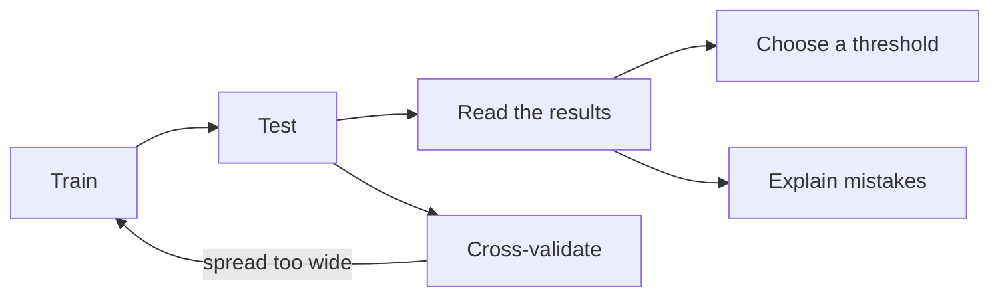

After training, find out how good the model is, how far that answer can be
trusted, and why it predicts what it does. Most of this lives in Data
Studio's **Results** job, the **Train > Test** and **Train > Evaluate**
menus, and the **Tools > Evaluation** and **Tools > Model** menus.

## The path after training

1. **Test** the model on the rows it never saw: **Train > Test > Run
   Test** (F8). [Test a trained model](test-a-trained-model.md)
2. **Read the results** in Data Studio's **Results > Test**: the headline,
   the confusion matrix, the classes, the errors, the curves.
   [Read test results](test-results.md)
3. **Choose the decision rule** and check the probabilities.
   [Choose a threshold and calibrate](threshold-and-calibration.md)
4. **Check how far one test can be trusted** with cross-validation, and
   whether more data would help with a learning curve.
   [Cross-validation and learning curves](cross-validation-and-learning-curves.md)
5. **Explain** what the model looks at: the Model window's Explain tab for
   one row, Feature Importance for the columns.
   [The Model window](../../main-window/model-window.md),
   [Measure feature importance](feature-importance.md)

## Pages in this section

- [Test a trained model](test-a-trained-model.md): Run Test, Quick Test,
  testing a checkpoint.
- [Read test results](test-results.md): the Results job and its Test view,
  keeping a test as a node.
- [Choose a threshold and calibrate](threshold-and-calibration.md)
- [Cross-validation and learning curves](cross-validation-and-learning-curves.md)
- [Measure feature importance](feature-importance.md)
- [Chat with or continue text from a language model](language-model-generation.md)
- [Plot data](plotting.md), with [Plot types](plot-types.md),
  [Plots of model results](model-result-plots.md),
  [Maps, flows and hierarchies](plot-maps-and-flows.md),
  [3D plots, networks and trees](plot-3d-and-networks.md),
  [Plot data on the canvas](plot-node.md) and
  [Plots from Python](plots-from-python.md)

Reference: [The Model window](../../main-window/model-window.md),
[Visualization nodes](../../reference/nodes/categories/visualization.md).
