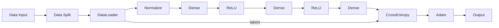

Use this to wire nodes into a graph: data flows from an output pin on the
right side of a node to an input pin on the left side of the next.

## Make a link

1. Point at the small circle on the right edge of a node (an output pin).
2. Drag to a circle on the left edge of another node (an input pin) and
   release.

You can also drag from an input to an output; the link is the same. If the
link appears, it is made. If it snaps back, it was refused; see
[When a link is refused](#when-a-link-is-refused).

The **Multiclass image classification** example graph is linked like
this (the Data Loader's second output carries the labels to the loss):

Open it from an empty canvas (**Open an example graph**) to see the exact
pins of a working graph.

## Read a pin

Hover a pin. The tooltip shows the node, whether it is an **Input** or
**Output**, **Pin:** (its name), **Type:** (what it carries),
**Connections:** (how many links, or **Not connected**) and what the pin is
for.

### Pin types

| Type | Carries |
| --- | --- |
| **Tensor** | Numbers flowing through the model or a data step. |
| **Labels** | The targets the model learns. |
| **Parameters** | Model parameters. |
| **Loss** | A loss value. |
| **Optimizer** | An optimizer. |
| **Dataset** | A dataset. |
| **Environment** | Simulation environment copies, for reinforcement learning. |

## Which pins connect

- An output connects to an input. Two outputs or two inputs never connect.
- The types must be the same, unless one side is **Tensor**: a Tensor pin
  connects to any type. So Labels to Loss is refused, but Tensor to Labels
  is allowed.
- A normal input takes **one** link. The **Input 3+** pin of merge nodes
  such as Concatenate and Add takes any number.
- A node cannot link to itself, and the same link cannot be made twice.
- A link cannot cross the border of an expanded subgraph. Collapse it first.

The canvas does not check for loops when you link. **Compile** reports
them.

### Pin colours

On the canvas a pin's colour shows the node's state, not its type:

| Pin | Means |
| --- | --- |
| Hollow, neutral colour | Not compiled yet. |
| Filled, warning colour | The node failed to compile. |
| Hollow, green | Compiled. |
| Filled, green | Trained, or running now. |
| Filled, red | The node failed during a run. |

To see what a pin carries, hover it, or select the node and read the
**Inputs** and **Outputs** in the **Info** panel, where each type has its
own colour.

Hover a link next to a node that will not compile to read
**&lt;node&gt;: will not compile** and the compiler's message.

## When a link is refused

When a link breaks a rule above, it snaps back. The canvas shows no
message. The reason is written only to the log:

1. Open the **Console** and its **Logs** tab.
2. Type `Link validation failed` in **Search messages**.
3. Read the reason at the end of the newest line:

| Reason | What to do |
| --- | --- |
| `Incompatible pin types` | Link to a pin of the same type, or to a Tensor pin. |
| `Target pin has reached maximum connections` | The input already has its one link. Remove that link first. |
| `Connection already exists` | Nothing to do; the link is there. |
| `Cannot connect node to itself` | Link to another node. |
| `Source must be an output pin` / `Target must be an input pin` | Drag between an output and an input. |
| `Collapse the subgraph before changing external connections.` | Collapse the subgraph, then link. |

### Linking a 4-D output to a flat layer

When you link the 4-D output of a convolution or pooling layer to a layer
that takes a flat input (such as Dense), the Engine asks
**&lt;layer&gt; needs a flat input** and offers **Insert Flatten**. Click it to
add a Flatten node between the two with both links; **Cancel** adds
nothing. **Ctrl+Z** removes the Flatten again. A node with a shape problem
shows a warning triangle; hover it for the suggestion.

## Remove a link

There is no right-click menu on a link, and the **Delete** key removes
nodes, not links.

1. Hold **Ctrl**.
2. Drag the end of the link at the input pin away from the pin.
3. Release it on an empty part of the canvas. The link is removed.

**Ctrl+Z** brings it back. Deleting a node also removes its links.

To replace the link into an input, remove the old link first, then make the
new one.

## Related

- [Move around the canvas](canvas.md)
- [Compile and run a graph](compile-and-run.md)
