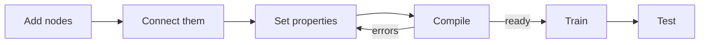

In the CyxWiz Engine you build a model, and the data preparation in front
of it, as a graph: nodes for each step, linked pin to pin, on the **CyxWiz
Studio** canvas. You do not need to write code; the Engine can also write
Python from the graph for you.

## The path to a first model

1. **Start a graph.** Open an example graph from the empty canvas, or add
   nodes one by one. [Move around the canvas](canvas.md)
2. **Add nodes.** A Data Input for your file, a Data Split, a Data Loader,
   the model's layers, a loss, an optimizer and an Output.
   [Find and add nodes](find-and-add-nodes.md)
3. **Connect them** from output pins to input pins.
   [Connect nodes](connect-nodes.md)
4. **Set properties**, such as the Data Input's file and label column or a
   layer's size, then load the data with **Apply**.
   [Set node properties](node-properties.md)
5. **Compile** (F7) and fix what the report finds, then **Train** (F5).
   [Compile and run a graph](compile-and-run.md)

## Pages in this section

- [Move around the canvas](canvas.md): pan, zoom, select, find, undo.
- [Find and add nodes](find-and-add-nodes.md): every way to add a node.
- [Connect nodes](connect-nodes.md): pin types, which pins connect, why a
  link is refused, removing a link.
- [Set node properties](node-properties.md): the Properties panel, node
  dialogs, defaults and presets.
- [Compile and run a graph](compile-and-run.md): the compile report, run
  modes, and what Train does first.
- [Fix missing values before training](fix-missing-values.md)
- [Organise a graph with groups, frames, notes and names](groups-frames-and-names.md)

## The panels you use here

- [The Nodes panel](../../main-window/nodes-panel.md)
- [The Properties panel](../../main-window/properties.md)
- [Node dialogs](../../main-window/node-dialogs.md)
- [The Studio bar](../../main-window/toolbar.md)
- [Keyboard shortcuts](../../reference/shortcuts.md)

## More on graphs

- [Branched graphs](../../usage/branched_graphs.md): skip links, merges and
  multi-branch models.
- [Patterns](../../main-window/pattern-browser.md): ready-made blocks and graphs.
