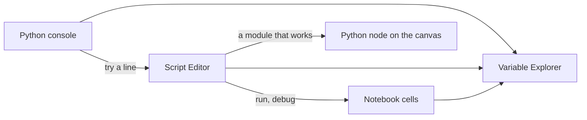

The Engine runs Python inside itself. Scripts in the Script Editor, the
cells of a notebook, the Python console and Python nodes on the canvas all
use the same interpreter, with the `pycyxwiz` module (the Engine's tensors,
layers, linear algebra, signal and statistics functions) ready to import.
Python needs a project open and a Python installation the Engine can use;
see [Python and project environments](python-environment.md).

## The path from a first line to a node

1. **Try a line** in the Python console (**Script > Open Python Console**,
   F12). [Use the Python console](python-console.md)
2. **Write a script** and run it (F5), a selection (F9) or a section
   (Ctrl+Enter). [Write and run scripts](script-editor.md)
3. **Debug it** with breakpoints, steps and watches (F10).
   [Debug a script](debug-a-script.md)
4. **Work in cells** when you explore: Jupyter `.ipynb` notebooks and
   `.cyx` notebooks. [Notebooks](notebooks.md)
5. **Look at what the code made**: every variable, its size and value, and
   its data in the Table Viewer. [The Variable Explorer](variable-explorer.md)
6. **Turn it into a node** when a function works.
   [Make your first Python node](../../sdk/get-started/first-python-node.md)

## Pages in this section

Write and run code:

- [Write and run scripts](script-editor.md): new scripts, the editor, run,
  run a selection or a section, save, completion and problems.
- [Debug a script](debug-a-script.md): breakpoints, stepping, watches, the
  call stack.
- [Notebooks](notebooks.md): cells, the kernel, outputs, figures, the keys.
- [Use the Python console](python-console.md): the Python REPL session of
  the Console.
- [The Variable Explorer](variable-explorer.md): the values in the Python
  session and in each notebook.

Set up Python:

- [Python and project environments](python-environment.md): which Python
  runs, the project's environment, installing packages.
- [Startup scripts](startup-scripts.md): code that runs at the start of
  every Python session.
- [Script templates](script-templates.md): starter scripts in the Engine
  folder.

Reference:

- [The .cyx document format](cyx-documents.md): CyxWiz scripts and
  notebooks as plain text.
- [Console and logs](../../usage/console_logs.md): the Console's Logs and
  Commands sessions.
- [Keyboard shortcuts](../../reference/shortcuts.md): the Script Editor,
  notebook, debugger and Variable Explorer keys.

Go further with Python:

- [Write a module in Python](../../sdk/guides/python-modules.md): train
  from a script with `pycyxwiz`.
- [Python nodes](../../sdk/guides/python-nodes.md): describe a module as a
  node for the canvas.
- [Python API reference](../../sdk/python-api/index.md): every `pycyxwiz`
  function and class.
- [Plots from Python](../evaluation/plots-from-python.md): matplotlib
  figures in the Engine.
