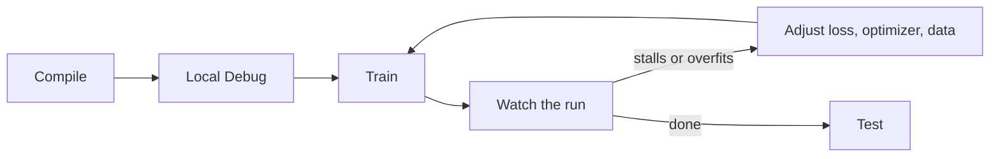

Training turns a graph into a trained model. You set the run on the graph's
nodes (the Data Loader for epochs, batches and checkpoints; the loss and
optimizer for how the model learns), press **Train** (F5), and follow the
run in the Training Dashboard. The trained model then goes to testing and
export.

## The path to a trained model

1. **Wire the loss and optimizer** and check that the graph compiles.
   [Losses and optimizers](losses-and-optimizers.md)
2. **Debug one sample** before a long run (F6).
   [The Studio Debugger](studio-debugger.md)
3. **Train and watch** (F5): the dashboard, pause, resume, stop.
   [Train a model and watch it](train-and-watch.md)
4. **Keep the best model** and stop when validation stalls.
   [Checkpoints, early stopping and resume](checkpoints-and-early-stopping.md)
5. **Test the model** on rows it never saw.
   [Evaluate models](../evaluation/index.md)

## Pages in this section

Run a training:

- [Train a model and watch it](train-and-watch.md): start, follow, pause,
  resume and stop a run, and read how it ended.
- [Checkpoints, early stopping and resume](checkpoints-and-early-stopping.md):
  the best checkpoint, early stopping, the checkpoint files, warm starts.
- [Training Dashboard](../../main-window/training-dashboard.md): every part
  of the panel.

Set up how the model learns:

- [Losses and optimizers](losses-and-optimizers.md): which loss for which
  task, the optimizers and their schedules.
- [Train on unbalanced classes](class-imbalance.md): class weights and
  balanced batches.
- [Learning-rate schedulers](../../reference/nodes/categories/training.md#learning-rate-schedulers),
  [Gradient clipping](../../reference/nodes/categories/training.md#gradient-clipping) and
  [Regularization nodes](../../reference/nodes/categories/regularization.md).
- [Start from pretrained weights](start-from-pretrained-weights.md):
  PyTorch and safetensors weight files.

Debug a model:

- [The Studio Debugger](studio-debugger.md): run Local Debug on one sample.
- [Layer capture](layer-capture.md): keep what every layer held during
  Local Debug and training.
- [Inspect layers](inspect-layers.md): the layer views of the Studio
  Debugger.

Search and special kinds of training:

- [Hyperparameter search](hyperparameter-search.md)
- [Neural architecture search](neural-architecture-search.md)
- [Metric learning](metric-learning.md): pairs, triplets and embeddings.
- [Fine-tune language models](fine-tune-language-models.md)
- [Generation previews](generation-previews.md): prompt a language model
  while it trains.

How it works:

- [What runs where on a GPU](../../concepts/gpu-providers.md)
- [Seeds and reproducibility](../../concepts/seeds-and-reproducibility.md)
